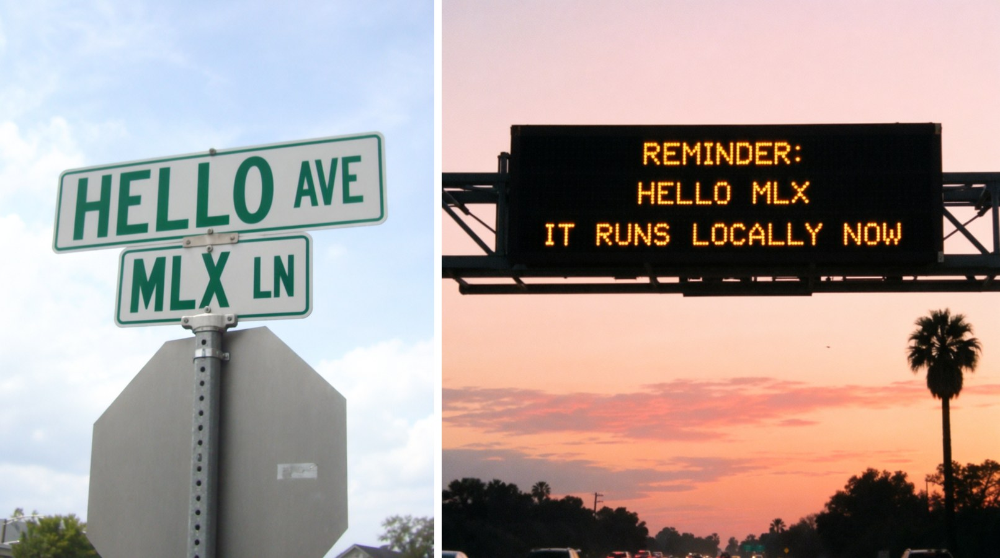
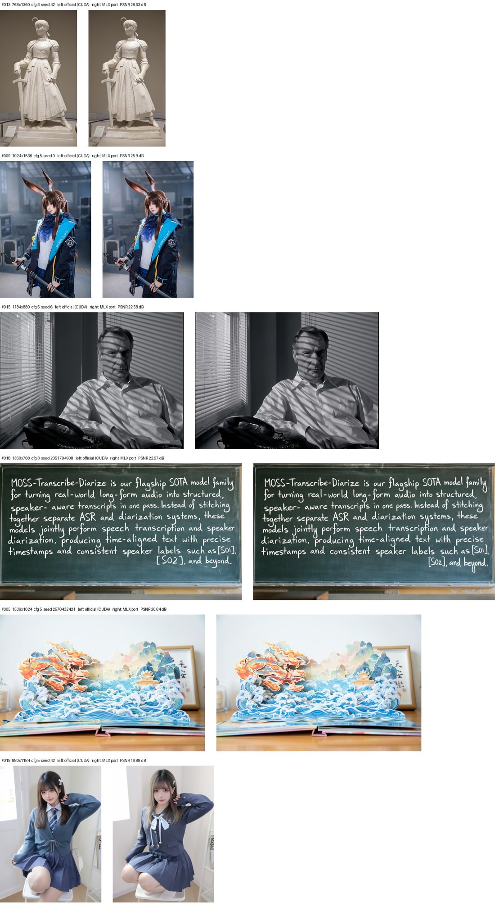

# moss-image-mlx

**MOSS-Image on Apple Silicon.** This is a pure-MLX port of OpenMOSS's 5B text-to-image DiT, the open model built for long bilingual (English and Chinese) text rendering and JSON layout control. The port is verified against the official PyTorch pipeline, reproduces the official sample gallery from its seeds, and runs a 1024² image in **9.3 GB** (8-bit tier) or **7.4 GB** (compact tier).


*All six renders come from the 8-bit tier at 1024², 50 steps, CFG 3, seed 42.*

## Install

```bash
pip install moss-image-mlx
```

macOS on Apple Silicon, Python ≥ 3.11. PyTorch is not needed.

## Use

```bash
moss-mlx "A minimalist book cover with a deep green background. Title at the top in large white letters: \"THE QUIET ORBIT\"." -o cover.png
```



*8bit tier, official defaults, about 12 minutes each on an M4 Pro. Reproduce both, same seeds: `moss-mlx --batch examples/hello_mlx.jsonl`.*

**Which tier you get:**
- The first run downloads a pre-quantized tier from Hugging Face and caches it:
  - **8bit** on Macs with ≥ 24 GB of memory;
  - **compact** below that.
- Pick explicitly with `--model 8bit`, `--model compact`, any Hugging Face repo id, or a local directory.
- The official bf16 checkpoints also work: `--model OpenMOSS-Team/MOSS-Image-SFT`.

```python
from moss_image_mlx import MOSSImagePipeline, Request, save
from moss_image_mlx.cli import resolve_model

pipe = MOSSImagePipeline(resolve_model("8bit"))
req = Request(prompt="A neon sign that reads \"OPEN LATE\" above a ramen bar", width=1024, height=1024, seed=7)
save(pipe(req), req, "ramen.png")
```

**Options:**
- **Several seeds or prompts, one model load:** `--seeds 1,2,3,4`, or `--batch jobs.jsonl` with one JSON object per line (any `Request` field, or `{"parameters": "path/to/parameters.json"}`).
- **Official examples:** `--parameters path/to/parameters.json` renders an OpenMOSS gallery example with its exact settings and seed.
- **Prompt cache:** prompts are cached, so re-rendering one with a new seed, size or step count skips the 9B text encoder. Disable with `--no-cache`.
- **Defaults** follow upstream: 50 steps, CFG 3, shift 5, block 22 skipped in the negative branch. Every PNG gets an upstream-style `.json` with its parameters next to it.

## Tiers

Measured on a Mac mini M4 Pro (48 GB), 1024², official defaults:

| Tier | Transformer + text encoder | Download | Peak memory | Text and layout vs bf16 (14-image eval) |
|---|---|---|---|---|
| [`8bit`](https://huggingface.co/VisualInference/MOSS-Image-SFT-MLX-8bit) | 8-bit + 8-bit | 14.1 GB | **9.3 GB** | **identical OCR on every prompt**, same layout boxes, 30.8 dB |
| [`compact`](https://huggingface.co/VisualInference/MOSS-Image-SFT-MLX-compact) | 8-bit + 6-bit | 12.1 GB | **7.4 GB** | all text still correct, 27.5 dB |
| [`Base 8bit`](https://huggingface.co/VisualInference/MOSS-Image-Base-MLX-8bit) | 8-bit + 8-bit (Base checkpoint) | 14.1 GB | 9.3–10.2 GB | reproduces the official sample gallery (Base) |
| official bf16 (`--model OpenMOSS-Team/MOSS-Image-SFT`) | bf16 + bf16 | 27.2 GB | 16.6 GB | reference (fastest: ~11½ min per image) |

**Memory:**
- Peaks are for a short prompt; a 650-token prompt adds about 1 GB.
- Stages load and free in turn, and the VAE decodes in seamless strips, so the peak is the largest single stage rather than their sum.
- Batch mode (`--seeds`, `--batch`) keeps the transformer loaded between images: the 8bit tier then peaks at about 10.8 GB.

**Speed:** a 1024² image at the official 50 steps with CFG takes about 12½ minutes on an M4 Pro. The model is compute-bound, so quantization saves memory, not time. Few-step turbo support is next.

**Rejected tiers:**
- *4-bit text encoder:* it reflowed a multi-line paragraph out of order in one of two runs, and saved no peak memory.
- *6-bit and smaller transformers:* too much error at the low-noise steps that settle fine detail.

## Why this port

| | moss-image-mlx | mlx-vlm `main` (2026-10-17) |
|---|---|---|
| Peak memory, one 1024² image | **9.3 GB** (8bit) / **7.4 GB** (compact) | 38.7 GB |
| Download | 14.1 / 12.1 GB | 27.2 GB |
| Official seeds reproduce official images | **yes** (torch CPU-generator noise, training-grid schedule) | no (MLX RNG) |
| Quantized tiers with text-fidelity evidence | **yes** | bf16 only |
| Prompt cache, batch/resident mode, layout checker | yes | no |
| Time per 1024² image (M4 Pro, 50 steps) | ~12½ min (quantized tiers), ~11½ min (bf16) | ~11¾ min (bf16) |

*mlx-vlm figures were measured on the same machine with its default pipeline. Its peak comes from an uncapped fp32 VAE decode.*

## How it was verified

All checks compare against the official `pipeline_moss_image.py` running in PyTorch 2.14 on the CPU.

| Check | Result |
|---|---|
| Sampling schedule (sigmas snapped to the training grid) | **bit-identical**, including torch's fused-multiply-add `linspace` |
| Starting noise for a seed | matches torch's CPU generator to 2e-6 |
| VAE decode | max error 1.5e-5 |
| Text encoder | identical tokens; per-token cosine 0.9997–0.9999 |
| Transformer velocities | at the bf16 noise floor at every timestep; agrees with mlx-vlm's independent implementation |
| **End to end in fp32** | **69.7 dB vs torch fp32**: the implementation is exact; bf16 differences are rounding |
| Official gallery, 6 samples, official seeds | **all six reproduce the official composition**; five also match in detail at 20.8–28.6 dB. With this model, bf16 rounding alone moves an image about 23 dB (measured) |



## Layout prompts

MOSS-Image takes a JSON layout as the prompt. Boxes are `[y_min, x_min, y_max, x_max]` in pixels, with the canvas centre as the origin. Check a layout against the size you will render, and preview its boxes, before spending minutes on an image:

```bash
moss-mlx-layout check poster.json --size 1024x1024 --preview boxes.png
moss-mlx "$(cat poster.json)" --width 1024 --height 1024 -o poster.png
```

`moss_image_mlx.layout.from_top_left()` and `from_normalized_1000()` convert the usual box conventions.

## Exporting your own tier

```bash
moss-mlx-export --model path/to/MOSS-Image-SFT --dit-quant 8 --te-quant 8 --out MOSS-Image-SFT-MLX-8bit
```

Quantization runs on the CPU, one module at a time; an export takes about 30 s.

## Limitations

- Dense, very small text can still garble, as it does in the original model.
- The SFT checkpoint shows faint vertical banding on some skies and walls. That is the upstream checkpoint, not the port; a fix is planned.
- Speed: see above. A turbo (few-step) path is the next release.
- "Runs on 16 GB Macs" is an expectation from the measured peaks, not yet tested on a 16 GB machine. Reports welcome.

## License

Apache-2.0. MOSS-Image is © OpenMOSS (Apache-2.0); the text encoder is Qwen3.5-9B (Apache-2.0); the VAE is FLUX.2 with the FLUX.2 small decoder (Apache-2.0). See [NOTICE](NOTICE). This is an independent port, not affiliated with OpenMOSS.
