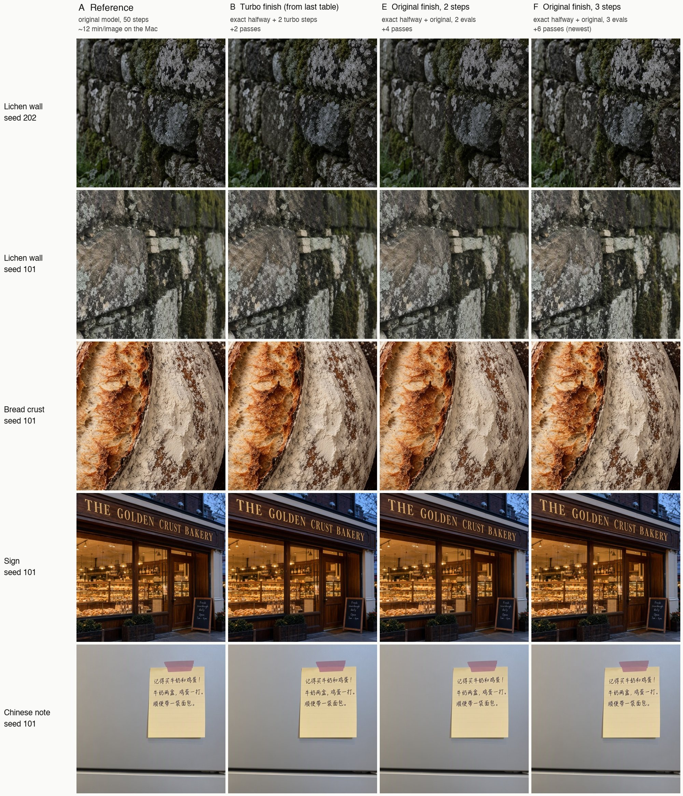
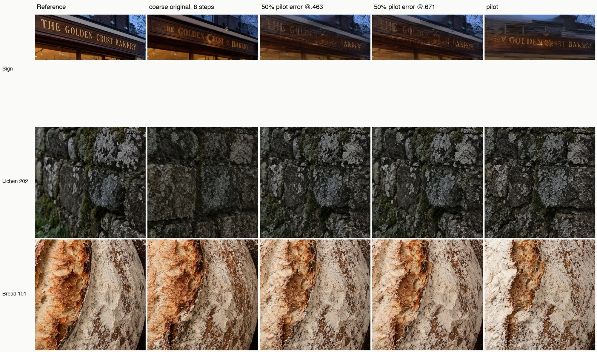

# MOSS-Image turbo research

Research notes on a fast ("turbo") sampler for [MOSS-Image](https://huggingface.co/OpenMOSS-Team/MOSS-Image-SFT) on Apple Silicon. The goal was close to the original model's 50-step quality, about 12 minutes per image on an M4 Pro, in about 2 minutes.

This repository is **documentation only**: the research log, reports, plans, evaluation method and comparison images. The MLX port itself lives at [felix-ab/moss-image-mlx](https://github.com/felix-ab/moss-image-mlx). Trained weights are not published yet.

*Held-out prompts never seen in training. Each row: original model, 50 steps | new turbo, 15 passes | the earlier distilled turbo.*

## The short version

1. **The problem: stamping.** Community few-step adapters for MOSS-Image (trained with DMD) produce stamped, repeated textures: lichen turns into daisies, pebbles into beads, bread into a lattice. The result looks darker and waxier than the original.
2. **Located it, rather than guessing.** Starting from the original model's exact image at step 42 of 50, a 2-step finish already reproduces the reference. So everything depends on reaching that midpoint accurately. Stamping comes from repeated applications of the distilled mapping in the middle of the trajectory, and gets worse with each application.
3. **The design.** A CFG-free student trained by regression onto the original model's own trajectory (not distribution matching) handles the early steps. Then the original model's own 4-step finish runs. A rank-64 LoRA, about 2,000 images at about 1 MP in 9 aspect ratios.
4. **The key training fix.** Training the student on its own drifted states with "teleport" targets (jump back onto the stored path) makes it average two paths, which shows up as ghosting. Using the teacher's own continuation instead ("relabelled" targets) removes it. The kind of error matters, not its size: a valid but different path stays clean; an averaged one ghosts.
5. **A measured hybrid schedule.** One guided original-model step placed at each of the student's 6 slots in turn showed that **slot 2** (σ .957 → .919) is where lettering is decided. One step there fixes large text without bringing back stamping.
6. **Result.** 15 passes, about 119 s per image, 6.2× faster than the official sampler. Stamping is at the reference's level, fine detail and tone match, and text is on par with the earlier turbo. It passes a pre-registered decision rule on the test set and 32 held-out prompts. Remaining gaps: small text, and over-organic regular geometry such as fence-shadow grids. A third training stage targeting those ($13.10) improved the fence-shadow grids and small text on a second seed, with a few one-seed regressions; the final checks are running on the Mac.

## Documents

**Start here:** [docs/technical-writeup.md](docs/technical-writeup.md). It covers the released `--turbo` design decision by decision: what motivated each one, how much it contributed (and how well isolated that evidence is), what failed, and what remains unproven.

| Document | What it is |
|---|---|
| [docs/technical-writeup.md](docs/technical-writeup.md) | The technical write-up of the release |
| [docs/results-and-decisions.md](docs/results-and-decisions.md) | Current results (including stage 3), images, and every decision taken so far |
| [docs/how-the-numbers-work.md](docs/how-the-numbers-work.md) | The evaluation metrics explained, with formulas |
| [docs/v2-review.md](docs/v2-review.md) | Evidence review that shaped the v2 training design |
| [docs/m6b-report.md](docs/m6b-report.md) | Mechanism report: where the gap between the turbo and the original comes from |
| [docs/m6b-plan.md](docs/m6b-plan.md) | The pre-registered evaluation protocol and decision rule |
| [docs/training-proposal-v2.md](docs/training-proposal-v2.md), [docs/training-proposal-v1.md](docs/training-proposal-v1.md) | Training proposals, with cost estimates |
| [docs/prompt-spec.md](docs/prompt-spec.md) | How the 2,000-prompt training set and the held-out sets were designed |
| [docs/m4-turbo.md](docs/m4-turbo.md), [docs/m5-overnight-report.md](docs/m5-overnight-report.md), [docs/m5-handoff.md](docs/m5-handoff.md) | Earlier phases: the first turbo profile and the overnight texture study |
| [docs/research-log.md](docs/research-log.md) | The full chronological lab notebook, including dead ends and mistakes |

## Key figures

| | |
|---|---|
|  |  |
| Where one extra original-model step helps (slot 2 fixes the headline) | Relabelled vs teleport training targets |
|  |  |
| Original-model finish vs the turbo-adapter finish from the same midpoint | Valid-path error stays clean; averaged error ghosts |

## Credits and licenses

- **Base model:** MOSS-Image SFT by OpenMOSS, Apache-2.0.
- **Destripe LoRA:** nynxz/MOSS-Image, Apache-2.0.
- **Earlier turbo adapters evaluated:** lodestones and akhaliq (DMD) for MOSS-Image.
- **Metrics:** DINOv2 (Meta) for the texture-recurrence metric; Apple Vision for OCR.
- **Literature consulted:** Spectrum (arXiv 2603.01623) was evaluated and not used. Correction Training (arXiv 2610.14136), DP-DMD (2602.03139) and others are discussed in the research log.

Documentation and images in this repository: CC BY 4.0.
