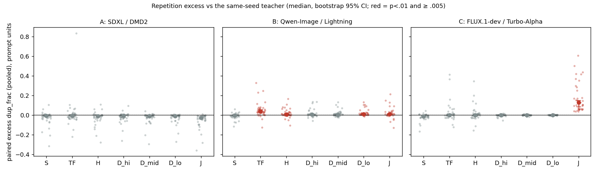
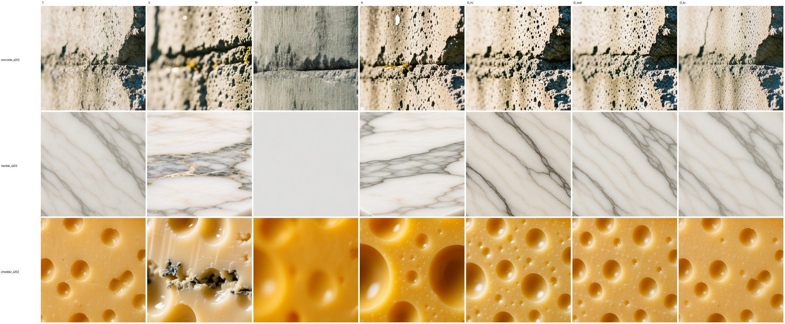
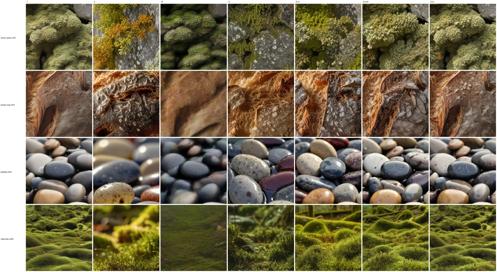

# Does stamping generalize? A cross-family test

*Run 22–23 October 2026, after the release. The design was pre-registered: hypotheses, metric, decision rule and sample size were fixed before any image was generated.*

**Short answer: no.** In three independent families of distilled few-step models, the distilled student does **not** repeat texture more than its own many-step teacher. The stamping documented in this repository is a property of the community DMD adapters for MOSS-Image, not of few-step distillation in general. At least, that holds as far as this score can measure it.

## What was tested

| Family | Teacher (many steps, official guidance) | Distilled student (native settings) |
|---|---|---|
| A | SDXL base | DMD2 |
| B | Qwen-Image | Qwen-Image-Lightning (LoRA) |
| C | FLUX.1-dev | FLUX.1-Turbo-Alpha (LoRA) |

**Prompts:** 40 texture-heavy prompts (lichen, bark, bread, pebbles, gravel, fur, moss, marble, …) plus a few legitimately regular controls. Each was run with 3 seeds at ~1 MP.

**Metric:** the same paired score used for MOSS ([how-the-numbers-work.md](how-the-numbers-work.md)), phase-pooled. It is the share of textured DINOv2 patches with a near-duplicate at least 56 px away, minus the teacher's value for the same prompt and seed.

**Conditions per family:**
- the teacher (T);
- the native student (S);
- the teacher on the student's coarse grid with a good solver (TF), which separates "few steps" from "distilled network";
- a teacher-first-step hybrid (H), the fix from Gandikota & Bau;
- exact teacher states spliced into the student at three handoff points (D_hi / D_mid / D_lo), the dose-response from the MOSS study.

**Sanity gates:**
- a splice at the highest noise level reproduces the student bit for bit in all three families;
- a teacher-to-teacher splice reproduces the teacher, bit for bit in A and C, and within a few /255 in B.

**Compute:** one rented H100 for about 4 hours, $16.08.

## Result

| Condition | A: SDXL / DMD2 | B: Qwen / Lightning | C: FLUX / Turbo-Alpha |
|---|---|---|---|
| **S** (native student vs teacher) | **−.008** [−.017, −.001] | **−.006** [−.011, −.001] | **−.013** [−.018, −.004] |
| TF (teacher on the student's grid) | −.008 | **+.036** | +.000 |
| H (teacher first step) | −.012 | +.006 | −.001 |
| D_hi / D_mid / D_lo (splices) | ≈ −.01 throughout | +.004 / +.004 / **+.011** | ≈ 0 throughout |

Values are medians over 40 prompts, each averaged over 3 seeds. Brackets are bootstrap 95% intervals. The pre-registered rule required S to exceed T (p < .01, median ≥ .005) in at least two families. **It holds in none.** The dose-response and first-step hypotheses depended on that, so they were not evaluated.

*Each dot is one prompt. Red marks a condition where the excess is significant and at least .005. Family C's J condition (a single jump to the clean image) is a blurry image the score misreads as repetitive. The blur guard flags it, and it isn't used.*

## What the images show

- **These teachers are already "repetitive" by this measure.**
  - **Teacher medians:** .027–.035, against ≤ .009 for real photos of lichen and bark, and .013 for the MOSS 50-step bread reference.
  - **Example:** at full resolution, the SDXL teacher lays a uniform fine speckle over bark and stone.
  - **Consequence:** the paired score assumes the teacher is a clean baseline, and here it isn't. A student that stamps could still score below its teacher if it also removes the teacher's uniform micro-texture.
- **Native students re-frame the picture,** often to a closer macro view with shallow depth of field (LPIPS to the teacher .40–.69). So native pairs aren't matched in structure; the splices are.
- **One real repetition effect, in a different form.** Spliced onto exact teacher states, Lightning's finishing steps add a fine checker/woven micro-texture to concrete, marble and cheddar (D_lo p = 2e-7). It is strongest with the *fewest* student steps, which is the opposite of the MOSS dose-response. It reads as a learned finishing texture, not motif-level stamping.
- **The coarse grid alone repeats in family B:** TF, +.036, is the largest excess in the run.

*Family B. Columns: T, S, TF, H, D_hi, D_mid, D_lo. The spliced columns keep the teacher's composition but add fine regular micro-texture, best seen on the cheddar.*

*Family A, same column order. The DMD2 student and splices give no measured excess over the teacher.*

## Standard metrics miss this axis

FD-DINOv2 and LPIPS rank the conditions by distance from the teacher (D_lo < D_mid < D_hi < S in every family), and that ordering is unrelated to repetition. In family B, D_lo is the condition *closest* to the teacher by FD and LPIPS, yet it carries the visible lattice. This supports the reason a dedicated repetition score is needed. It doesn't rescue the generality claim.

## What this changes

- **Stamping stays a MOSS finding.** The dose-response, the exact-state oracles, the per-image separation (AUC 0.98) and the design built on them all stand for MOSS-Image and its community DMD adapters. None of it is shown to hold for distillation in general.
- **The paired score needs a clean reference.** Two ways forward:
  - compare against real-photo distributions per material;
  - test DMD-family students on a base whose teacher is clean on the score, as the MOSS teacher is.

**Untested here:** whether MOSS-specific factors cause the stamping. Candidates are the adapters' training captions (compact JSON scene graphs), full-strength guidance at every noise level in their distillation target, and a training-noise distribution weighted toward high noise.
