# Stamping: why fast image models repeat themselves, and a turbo that doesn't

*Interim technical write-up, 22 October 2026 · [moss-image-mlx](https://github.com/felix-ab/moss-image-mlx) 0.2.0*

This document covers Felix Brener's MOSS-Image turbo: the visual defect in community "turbo" adapters, the oracle experiments on exact teacher states, the 15-pass sampler on PyPI, and what the latest analysis adds. It is written for technical readers outside image generation. Every number comes from the research log ([research-log.md](research-log.md); phases cited inline) or its data files in the private research workspace. The release itself is documented in [technical-writeup.md](technical-writeup.md), and the metrics in [how-the-numbers-work.md](how-the-numbers-work.md).

> **In one paragraph.** Few-step "turbo" adapters for the 5B MOSS-Image model, trained with distribution-matching distillation (DMD), are fast. But they paint organic surfaces with copies of one motif: lichen becomes identical rosettes, bread crust a lattice, pebbles uniform beads. We call this **stamping**. We cached the full 50-step model's exact intermediate states and spliced other samplers onto them. That showed two things: stamping grows with each distilled step taken in the mid-noise band, and the original model can finish faithfully from mid-trajectory on its own. So the released turbo distils only the first, composition half of the trajectory. It uses a small regression-trained student, plus one guided original-model step where lettering forms, and leaves the detail half undistilled. It takes **15 network passes instead of 100** (~119 s vs ~12½ min on an M4 Pro, 6.2×) and stamps no more than the original.
>
> **The latest analysis** adds three things:
> - a per-image stamping score that separates DMD outputs from clean ones (AUC 0.977);
> - evidence that stamping is not the known "first-step diversity collapse" of distilled models;
> - a matched-state probe showing that the DMD student overcommits fine detail at σ 0.919, while our student tracks the teacher.
>
> **All of it is one base model with small samples.** A pre-registered cross-family test (22–23 October) found that stamping does **not** generalize: in SDXL/DMD2, Qwen-Image/Lightning and FLUX.1-dev/Turbo-Alpha, the distilled student repeats texture no more than its teacher. Stamping is a property of MOSS-Image's community DMD adapters ([cross-family-test.md](cross-family-test.md), §7.5).

| | |
|---|---|
| Network passes, turbo vs the official 50-step CFG sampler | **15 vs 100** |
| Time per ~1 MP image, M4 Pro, 8-bit | **~119 s vs ~743 s (6.2×)** |
| Stamping excess vs the reference, 8 held-out prompts | **−0.006** (old DMD turbo: +0.063) |
| Rented GPU for the released student (teacher data + training) | **≈ $37.5** |

---

## 1. A five-minute primer on few-step image generation

### Flow matching and the noise level σ

MOSS-Image (OpenMOSS, ~5B parameters) is a diffusion transformer trained with **flow matching**.
- **Generation:** it starts from pure Gaussian noise in a compressed latent space and integrates an ordinary differential equation toward a clean image. The network predicts a velocity, and a sampler takes steps along it.
- **The noise level σ** is the position on that path. σ = 1 is pure noise and σ = 0 is the finished latent, which a VAE decodes to pixels.
- **The official sampler** takes 50 Euler steps on a fixed grid (shift 5).

Different σ ranges decide different things. Roughly, in this project:
- **high σ** (near 1) sets composition and layout;
- **the mid band** (~0.93 → 0.46) organizes texture;
- **low σ** sharpens fine detail.

At any σ the network can also give its current guess of the final image, the **clean estimate** x̂₀. At high noise, a well-trained model's estimate is a blurry average of all the images consistent with the current state.

### Classifier-free guidance (CFG)

To follow the prompt closely, the official sampler runs the network twice per step, once with the prompt and once without. It then extrapolates from the second result toward the first by a factor: CFG 3 here, with block 22 skipped on the unconditional branch. That doubles the cost: **50 steps = 100 passes**, about 12½ minutes per image on an M4 Pro.

### Few-step distillation and DMD

**Distillation** trains a student to cover the path in a handful of large steps. Here the student is a LoRA adapter on the same network. There are two broad families:
- **Trajectory regression:** the student imitates the teacher's actual path from a given noise. It must match where the teacher goes.
- **Distribution matching (DMD):** the student is rewarded when its outputs look like samples the teacher finds plausible. Nothing requires it to reproduce any particular trajectory. This objective is mode-seeking: it may collapse onto typical-looking outputs.

**The community adapters** for MOSS-Image are DMD-trained: lodestones' 8-step adapter, and akhaliq's 4-step adapter, warm-started from it.

**The previous turbo:** the old `--turbo` in moss-image-mlx, called ***quality*** below, ran 2 guided original-model steps (to σ 0.926) and then 6 lodestones DMD steps: 10 passes, ~80 s.

**akhaliq's training code** (read in Phase M6b) showed three things:
- the DMD signal used the teacher at CFG 3 at every noise level;
- training noise levels were sampled mostly high (Beta(2.5, 1), ~5% below σ 0.3);
- ~70% of the prompts were text and signage.

The log notes these as plausible contributors to stamping. None was tested in isolation.

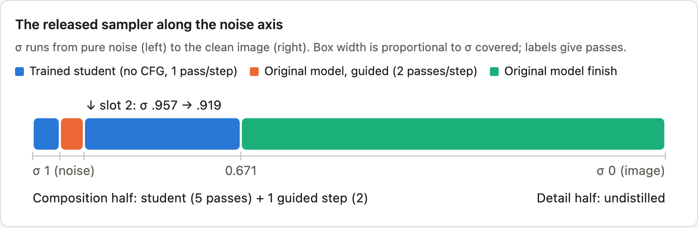

---

## 2. The defects, shown

Felix found each of these by eye before any metric existed. They are easy to miss in a thumbnail. So, unless stated otherwise, every figure below is a **1:1 crop**, with the same prompt and seed in every panel.

**A** is always the reference: the official 50-step sampler with nynxz's destripe LoRA, which removes the base checkpoint's faint vertical stripes.

### Stamping: one motif, copied

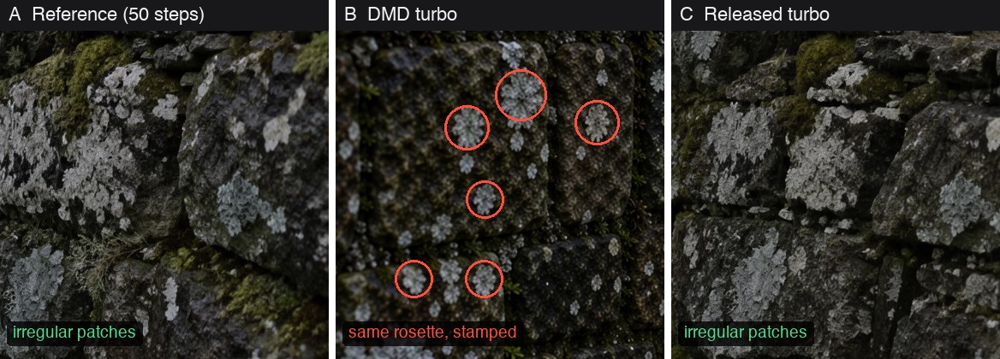

**Lichen rosettes** (test prompt "moss wall", seed 202). B, the *quality* turbo, turns lichen into the same six-petalled rosette, repeated across the wall, and the rest of the stone takes on a fish-scale pattern.
- On this seed, every fast method tried before the trained student showed rosettes (Phase 5g).
- The stamping score *missed* them (§3).

*What to look for:* count the rosettes that look alike in size, petal count and brightness. Real lichen (A, C) grows in patches with ragged, unique edges.

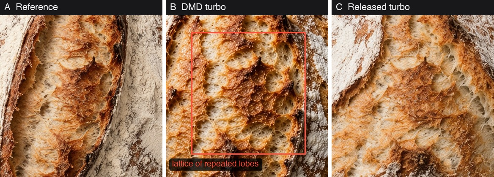

**Bread lattice** (seed 101). The reference's crumb is fibrous and torn. B's crumb, inside the box, is a net of near-identical rounded lobes with a regular pitch. At seed 7 the log describes it as "scalloped lobed crumb along the score; flour in regular star blotches" (Phase C1).

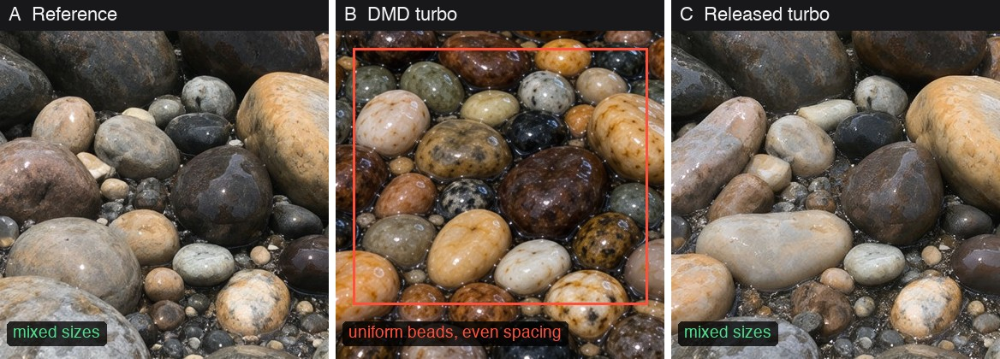

**Pebble beads** (held-out prompt, never used in training or tuning; seed 101). B packs evenly sized, evenly spaced glossy ovals, like a bead tray. A and C mix large and small stones. Stamping excess on this prompt: B +0.031, C −0.001.

### Ghosting: two answers averaged

Ghosting is a double exposure: two incompatible versions of a letter or face, overlaid. It is the signature of *averaging* two solutions (§4.3). Scalar text metrics do not see it: the OCR character score was 0.990 both with and without the fix shown in panel D below.

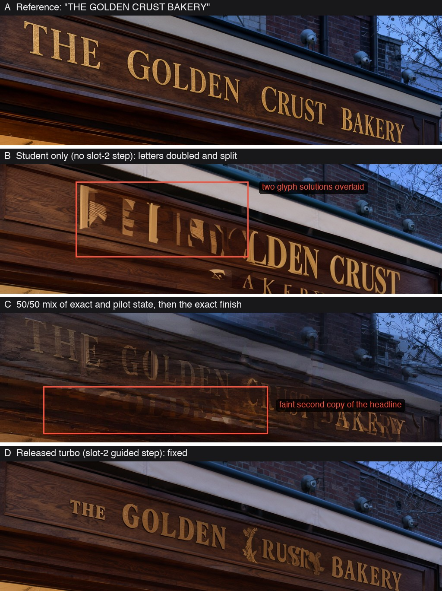

**The bakery headline** (test prompt, seed 101):
- **B: the trained student alone,** before the slot-2 step. "THE GOLDEN" is doubled and "BAKERY" is split.
- **C: an experiment, not a sampler.** It is a 50/50 mix of the exact state and the pilot student's state at σ 0.463, followed by the original model's finish. A faint second "GOLDEN" sits below the first.
- **D: the released turbo,** with one guided original-model step at σ 0.957 → 0.919. It reads correctly; the log notes a small decorative flourish on the C.

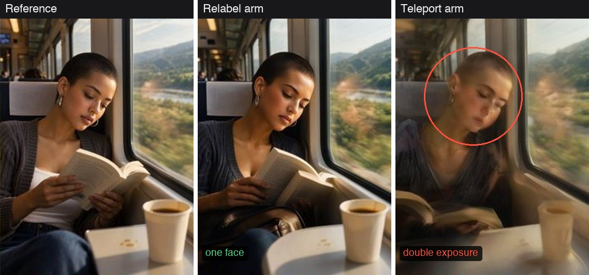

**Double-exposure face,** from the controlled training ablation (§5.3). Data, seeds and schedule are the same; only the training target on the student's own states differs. The crops come from the downscaled validation sheet and are enlarged 1.6×, so they are not 1:1.

### Over-organic regular geometry: the flip side

This is the released turbo's main known weakness, and Felix's catch: things that *should* repeat precisely come out slightly organic.

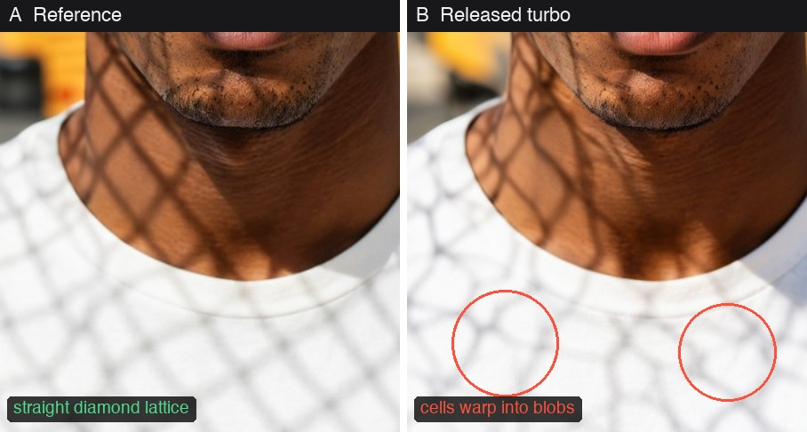

**Chain-link fence shadow** (held-out portrait, seed 101). A chain-link shadow is a grid of straight-sided diamonds. In B the cells bend into rounded, uneven shapes. Felix's note: "a chain-link fence shadow should fall as a grid but becomes organic blobs" (Phase 9a).

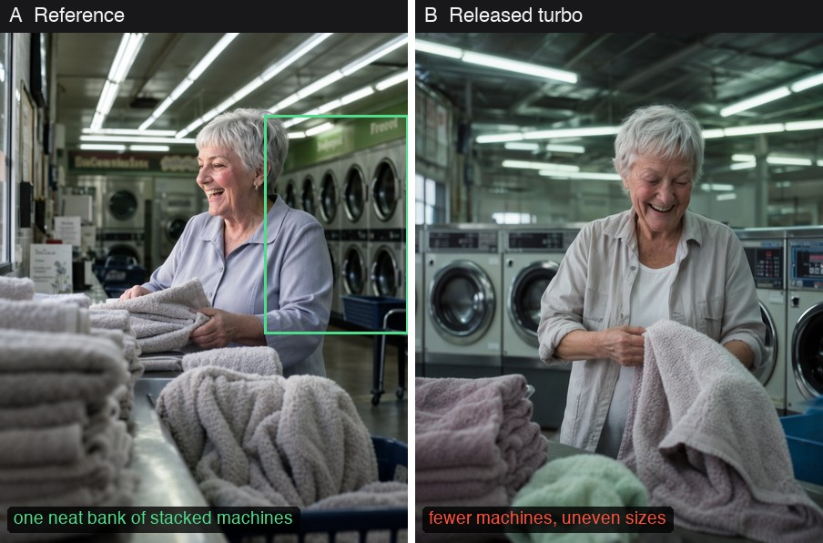

**Laundromat washers** (held-out portrait, full frame at 50%). Felix's note: the washers "should be neatly aligned but are scattered". The effect is subtle here.

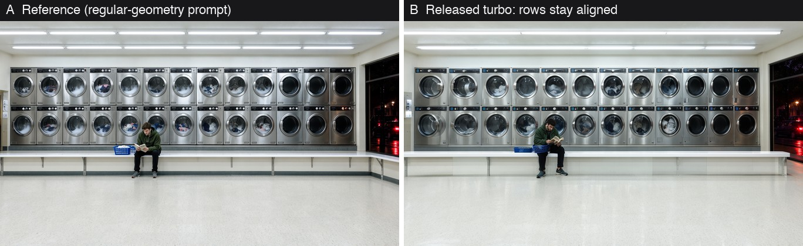

**A counter-example** from the 24-prompt regular-geometry set. On this dedicated prompt the release kept two straight rows of washers (Phase 9e: "washers aligned in both"), so the scattering is an inconsistency, not a rule. Across the 16 regular-geometry prompts, though, the release's repetition score is 0.072 *below* the reference: it under-repeats.

### Darkening

The DMD turbo also darkens and flattens light. Felix first read this as a deliberate "moodier" look. Mean luma (0–1):
- **test set** (18 prompts, seed 101): reference 0.475, *quality* 0.396 (Phase 5a);
- **held-out set:** a brightness difference of −0.049 for *quality* and +0.011 for the release.

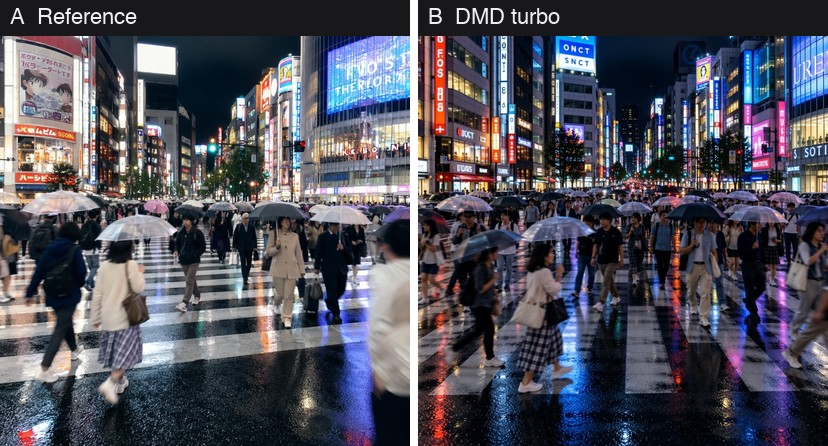
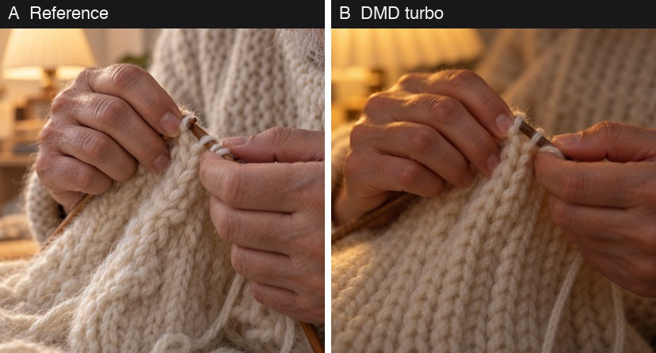

**Darkening** (full frames at 40%). Exact-state experiments split it into two sources: coarse guided steps, and each DMD application in the mid band (§4.1). The DMD hands also come out smoother. That is the kind of idealization the log describes for "weathered hands" prompts, which come out young and clean.

---

## 3. Turning "I can see it" into a number

Standard image metrics do not measure arrangement:
- **FID and KID** compare distributions over many images.
- **LPIPS and PSNR** compare one image with another.

A stamped image can have the reference's amount of fine detail, arranged as copies. So the project built a **within-image repetition score** (`recurrence.py`; derivation in [how-the-numbers-work.md](how-the-numbers-work.md)):

1. Tile the image at 1:1 into 14-px patches, and describe each with DINOv2-small layer-6 features.
2. Keep only textured patches (pixel std above 0.02).
3. For each one, find its most similar patch at least 56 px away.
4. `dup_frac` is the share of patches whose distant match has cosine ≥ 0.85.
5. Report the **excess** over the reference image for the same prompt and seed. Legitimate repetition (knitting, brickwork) cancels out.

**Calibration:**
- **Synthetic tests:** noise and blur leave the score unchanged (0.016 and 0.013, vs 0.015). Grid-aligned stamps covering ~5% of the area raise it to 0.044.
- **Real photographs (15, from Wikimedia):** for lichen, bark and bread, real photos and the reference agree (0.000–0.025), while *quality* sits 3–7× higher.
- **Excluded materials:** for crumpled paper and woven tweed the score does not separate real photos from turbos, so those materials are left out of every aggregate.

**Known blind spots:**
- **Phase sensitivity:** stamps not aligned with the 14-px patch grid barely register. The score missed the seed-202 lichen rosettes above.
- **Blur:** it misreads blurry images as repetitive (new in Phase 10, §7.4).

That is why every result was also checked by eye.

---

## 4. Diagnosis: oracles from exact teacher states

The most useful tool in the project was cheap:
1. Run the full 50-step guided sampler once.
2. **Store its exact state at a chosen σ.**
3. Continue from that state with any other sampler.

The resulting image shows the error a component *makes*, separated from the error it *inherits*. Each finding below set one design decision.

### 4.1 Stamping is a dose-response to distilled steps in the mid band

Start from the exact state at σ and finish with the DMD adapter. The later the start, the fewer DMD steps remain. Stamping falls with each step removed, so it is produced by the distilled steps themselves, even from a perfect starting state (Phases 5d, 5e).

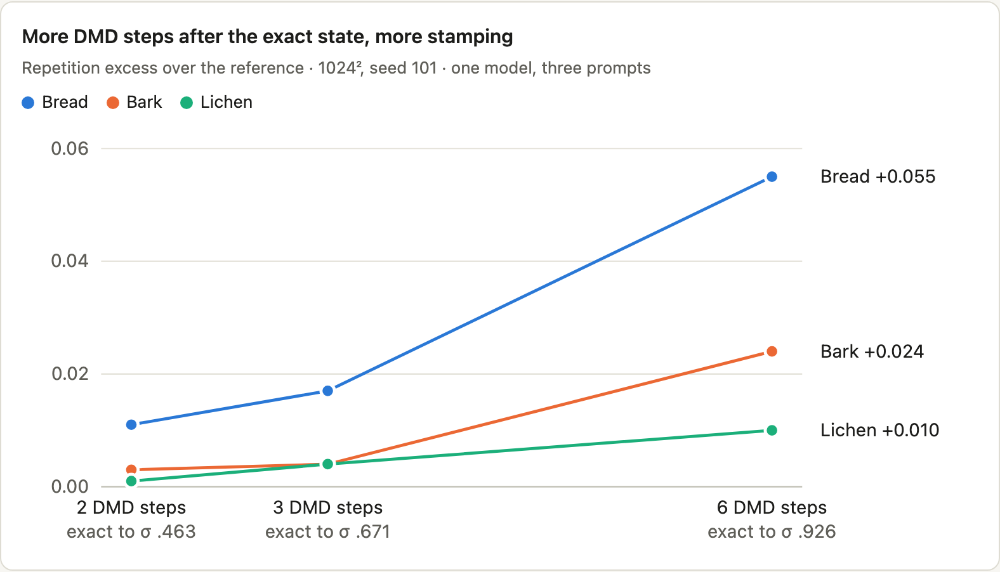

| Exact 50-step state to σ | DMD steps after | Bread | Bark | Lichen | Mean luma (ref 0.458) |
|---|---|---|---|---|---|
| 0.926 | 6 | 0.055 | 0.024 | 0.010 | 0.434 |
| 0.671 | 3 | 0.017 | 0.004 | 0.004 | 0.445 |
| 0.463 | 2 | 0.011 | 0.003 | 0.001 | 0.452 |

*Repetition excess over the reference. 1024², seed 101; one model, three prompts.*
- **Visual at σ 0.926:** "star flour, flower rosettes, fish-scale stone".
- **A coarser, confounded series** (768²) gave 0.079 / 0.043 / 0.033 / 0.024 / 0.019 / 0.000 for 8 / 6 / 4 / 3 / 2 / 0 adapter steps.

**Three controls support this reading:**
- **A better start does not help.** A more accurate 3–4-eval guided prefix to σ 0.926 left stamping unchanged or worse (Phase 5f).
- **It is not quantization.** The same adapters on bf16 weights give the same rosettes and lobes, with `dup_frac` within ±0.01 (Phase 1a).
- **It is not carried by a few weight directions.** Removing the top 3 to 1,024 regularity-attributed adapter SVD directions left the excess at 0.038–0.044, from 0.043.

**Decision:** no distilled step may run in the mid-σ band.

### 4.2 The finish does not need distilling

Six finishes were compared from the identical exact state at σ 0.463, on 7 images (Phase 6b).
- **The original model wins.** The undistilled model with a 2nd-order solver (DPM-Solver++(2M), 3 evaluations) lands **4.6× closer** to the reference than the 2-step DMD finish, with no excess stamping.
- **It saturates.** A 4th evaluation adds almost nothing (0.0044 vs 0.0047).

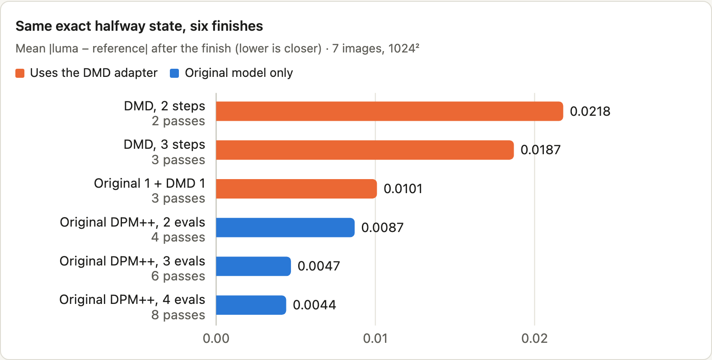

| Finish from exact σ 0.463 | Passes | \|img − ref\| | Detail Δ | Luma Δ |
|---|---|---|---|---|
| DMD adapter, 2 steps | 2 | 0.0218 | −0.029 | −0.008 |
| DMD adapter, 3 steps | 3 | 0.0187 | −0.006 | −0.006 |
| Original 1 step + DMD 1 step | 3 | 0.0101 | −0.028 | −0.004 |
| Original DPM++(2M), 2 evals | 4 | 0.0087 | −0.033 | −0.002 |
| **Original DPM++(2M), 3 evals** | **6** | **0.0047** | **+0.006** | **+0.001** |
| Original DPM++(2M), 4 evals | 8 | 0.0044 | n/r | n/r |

*n/r = not recorded. Handing off earlier, at σ 0.671, with a 4-eval finish is equally faithful: 0.0051, vs 0.0053 for the 0.463 handoff in the same run (Phase 6e).*

A second test showed that the finish is faithful to *whatever the prefix commits*. After *quality*'s stamped prefix, the same original finish kept the lichen daisies and the bread lattice (Phase 6c). **The whole problem was the prefix.**

### 4.3 The kind of prefix error matters more than its size

How accurate must the student's state be? Two experiments disagree in an instructive way (Phases 6d, 6f):
- **Averaging error.** Mix the exact state with an imperfect student state, x = (1 − α)·exact + α·student, then finish exactly. At a relative state error of only ~0.20, the sign ghosts (panel C in §2).
- **Coherent error.** A coarse 8-step run of the original model reaches the same σ with a *larger* relative error (0.32–0.51) and the same image difference (0.106). Yet it produces a legible sign and coherent lichen. It is a valid but different path; the image is just darker and softer.

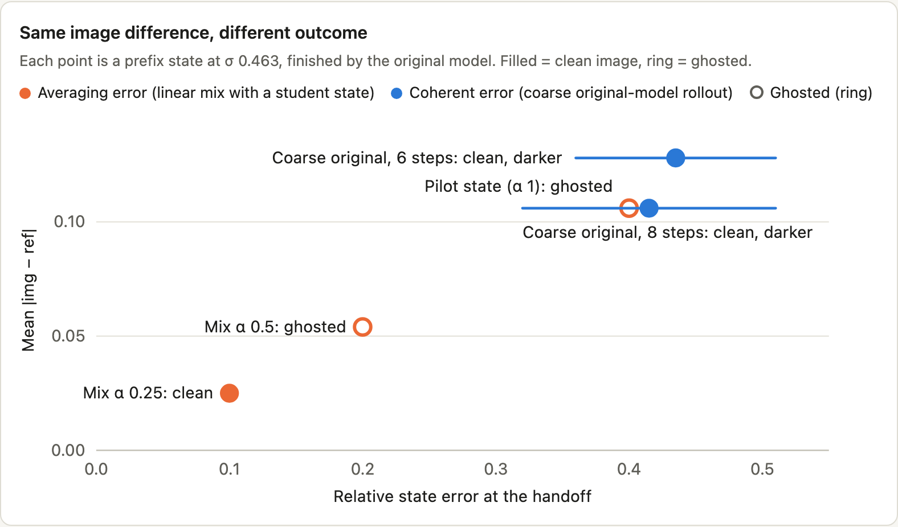

| Prefix state (handoff σ 0.463, original finish) | Relative state error | \|img − ref\| | Outcome |
|---|---|---|---|
| Mix α 0.25 | ≈ 0.10 | 0.025 | clean |
| Mix α 0.5 | ≈ 0.20 | 0.054 | ghosted |
| Pilot student state (α 1) | ≈ 0.40 | 0.106 | ghosted |
| Coarse original, 8 steps | 0.32–0.51 | 0.106 | clean, darker |
| Coarse original, 6 steps | 0.36–0.51 | 0.128 | clean, darker |

*Caveat from the log: linear mixing creates double exposures by construction. This setup therefore measures averaging-type error exactly, and it overstates the harm of coherent drift.*

**Consequences:**
- **Validation moved into image space,** after the real finish, because state error is a poor validation signal.
- **The training target had to be a valid flow,** not an average (§5.3).

### 4.4 Where to hand off

Comparing one guided Euler jump with the exact path shows where the trajectory is curved:
- **The release grid:** the last interval before 0.463 (0.671 → 0.463) has a single-jump error of 0.048–0.050.
- **A 6-step grid stopping at 0.671** stays at 0.004–0.024.

The student therefore stops at **σ 0.671**, before the curved section. This also means storing 35 rather than 42 teacher steps per training sample (~17% less teacher compute).

---

## 5. The released design

| Segment | σ | Network | Passes |
|---|---|---|---|
| Student steps 0–1 | 1 → 0.983 → 0.957 | trained student, no CFG | 2 |
| **Slot 2** | **0.957 → 0.919** | **original model, CFG 3 + block-22 skip** | **2** |
| Student steps 3–5 | 0.919 → 0.871 → 0.791 → 0.671 | trained student, no CFG | 3 |
| Finish | 0.671 → 0.536 → 0.373 → 0.193 → 0 | original model, DPM-Solver++(2M), CFG 3 | 8 |
| Throughout | | destripe LoRA (nynxz) at 1.5 | — |
| **Total** | | | **15** |

### 5.1 Distil only the composition half

The student is trained only on σ 1 → 0.671. Its ceiling is the oracle (exact state + original finish), which was visually indistinguishable from the reference on two seeds.

### 5.2 A regression student, not DMD

**The student:**
- a rank-64 LoRA on all 252 attention and feed-forward projections of the 42 blocks;
- run **without CFG**: 1 pass per step, with guidance learned implicitly.

**The loss** is plain velocity MSE onto the guided teacher's stored 50-step states, with no adversarial or distribution term.

On the 18-prompt test set (seed 101), the student-only pipeline compared with the DMD turbo (Phase 8h):

| Measure | Student pipeline (14 passes) | DMD turbo *quality* |
|---|---|---|
| Repetition excess (7 admitted prompts) | 0.012 | 0.066 |
| Detail Δ (latent high-frequency share) | −0.009 | −0.025 |
| Mean \|img − ref\| | 0.098 | 0.145 |
| Luma Δ | +0.037 | −0.080 |

**Not isolated:** this compares two whole systems, with different data, objectives and authors. DMD was never trained on our data.

### 5.3 Relabelled on-policy targets: the fix for ghosting

**The problem.** A student trained only on teacher states meets its own, slightly drifted states at inference (exposure bias). The standard fix trains on the student's own rollout states. That raises a question: what is the right target at a state the teacher never visited? Two candidates:
- **Teleport** (used in the pilot): the velocity that jumps back to the stored teacher state. From many nearby drifted states it points at one target, so the MSE-optimal answer is an *average*: the error type that ghosts.
- **Relabel** (released): run the guided teacher from the student's actual state over the same interval, and use that as the target. This is the DAgger idea (Ross et al. 2011). It accepts coherent drift, which is harmless.

**The ablation.** The two arms ran on two GPUs with identical data, draw order, seed and hyperparameters, for 2,000 iterations each. Only this target changed (Phase 8g):

| At iteration 2000 | Relabel | Teleport |
|---|---|---|
| Image metric, \|luma − ref\| (16 val prompts) | 0.090 | 0.088 |
| State relative error at σ 0.671 | 0.184 | 0.179 |
| Loss on own-rollout states | 0.07 | 0.92 |
| **Visible defects in 16 validation images** | **none seen** | **2** |
| Training wall time (A100) | 138 min | 100 min |

**What it shows:**
- The scalar metrics cannot tell the arms apart.
- The defect check can: the double-exposure face in §2, and garbled Chinese on a parcel.
- The evidence is thin: one seed, n = 16, and a defect count of 2 vs 0.

### 5.4 One guided step where lettering forms

**The problem:** the plain student ghosted the bakery headline and garbled an infographic title.

**The method:** following Felix's "alternating actors" idea, one guided original-model step (2 passes) was placed in each of the student's six intervals in turn, and the effect was measured (Phase 8j; 7 prompts, 1 seed):

| Guided step at | σ interval | Headline | Infographic title | Rep. bread / lichen / oak | Luma Δ |
|---|---|---|---|---|---|
| none (student only) | | ghosted | garbled | .003 / −.001 / .040 | +.029 |
| slot 0 | 1 → .983 | ghosted | — | .007 / .001 / .031 | +.009 |
| slot 1 | .983 → .957 | ghosted | fixed | .002 / −.001 / .019 | −.009 |
| **slot 2** | **.957 → .919** | **fixed** | **fixed** | −.002 / −.002 / .035 | +.015 |
| slot 3 | .919 → .871 | ghosted | — | .002 / −.001 / .040 | +.028 |
| slot 4 | .871 → .791 | ghosted | — | .001 / −.003 / .048 | +.029 |
| slot 5 | .791 → .671 | ghosted | — | .002 / −.002 / .049 | +.029 |

*— = not recorded.*

**What it shows:**
- For this model, large-glyph identity appears to be settled in a narrow band, around σ 0.96 → 0.92.
- The fix held at seed 202 and on the held-out set.
- **Evidence:** 7 prompts, of which only 2 text prompts showed visible failures.

### 5.5 Everything else

- **Data:** 1,998 prompts written to MOSS's own caption schema, at ~1 MP in 9 aspect ratios.
  - 41.5% are text (English, Chinese, bilingual).
  - All were leakage-checked against every evaluation prompt.
  - Teacher run: 1,983 samples in 7.4 h on 2× A100.
  - The released student saw only 2,000 (state, step) examples, at batch 1.
  - None of this was ablated.
- **Validation in image space:** every 500 iterations, the trainer runs the full inference path on 16 validation prompts and scores the images against the reference. The checkpoint is picked by that score, and the sheets are read by eye. The sheets, not the scalar, decided relabel vs teleport.
- **Destripe throughout:** nynxz's LoRA cuts the stripe score from 13.9 to 5.2 on the test set. Side effects: mean |Δimg| 0.018, and repetition unchanged.
- **Engineering:**
  - The student runs unmerged, as an fp32 low-rank path beside the 8-bit base, so quantization does not round it away.
  - The packaged sampler reproduces the research images bit for bit (max pixel difference 0).
  - Peak memory is 9.4 GB.

---

## 6. Results

**Setup:**
- 32 held-out prompts, never used in training or tuning;
- each at its own aspect ratio (~1 MP);
- seed 101, 8-bit tier;
- compared against the destriped 50-step reference.

| Measure | Released turbo | Old DMD turbo (*quality*) | Reference |
|---|---|---|---|
| Network passes | 15 | 10 | 100 |
| Time per image (M4 Pro, 8-bit) | ~119 s | ~80 s | ~743 s |
| Peak memory | 9.4 GB | 9.3 GB | 9.3 GB |
| **Stamping excess (materials + nature, n = 8)** | **−0.006** | **+0.063** | 0 |
| Fine detail Δ (latent HF share) | −0.004 | −0.022 | 0 |
| Mean \|luma − ref\| | 0.090 | 0.124 | 0 |
| Brightness Δ | +0.011 | −0.049 | 0 |
| English text, OCR character recall (n = 4) | 0.947 | 0.951 | 0.934 |
| Malformed faces/hands, ghosting (manual, 68 images) | none seen | none seen | |

*Log Phase 8m; timing Phase 9f.*

**The decision rule** was pre-registered and has four parts:
- no text regression;
- reference-anchored preference;
- no new defect class in 68 images;
- ≤ 120 s per image.

The release passed all four. Felix's verdict: "new turbo is clearly better", with the regular-geometry exception.

### Stage 3 (trained, not released)

A continuation run added 259 prompts for regular geometry and small text: 3,565 more iterations, $13.10. It came out about equal overall, so Felix released stage 2 and kept working on stage 3 (Phases 9e, 9f):

| Measure | Stage 2 (released) | Stage 3 |
|---|---|---|
| Regular geometry (16), repetition vs ref, s101 | −0.072 | −0.059 |
| Small text (8), OCR, s101 (ref 0.970) | 0.957 | 0.944 |
| Small text (8), OCR, s202 (no ref) | 0.914 | 0.955 |
| 32 earlier held-out, \|d\| / stamping excess | 0.0899 / −0.006 | 0.0887 / −0.010 |
| Visible regressions | — | garbled infographic headline; stadium rows warp (s101 only) |

---

## 7. Latest findings (Phase 10)

After the release, the question became whether stamping is a real, general and new phenomenon, rather than an artefact of our metric or our model. Four analyses so far; the fourth (§7.5) answers the generality question, and the answer is no.

### 7.1 The score separates DMD outputs from clean ones, image by image

**The images:** every scored image of an admitted material. That is bread, lichen and bark on the test set at both seeds, plus the 8 held-out material and nature prompts.

**The groups,** by sampler type:
- **DMD outputs** (n = 16): *quality* and akhaliq's 4-step adapter;
- **partial DMD blends** (n = 15);
- **non-DMD samplers** (n = 43): the oracle, the students, the released schedules, the coarse-teacher hybrid and the pilot.

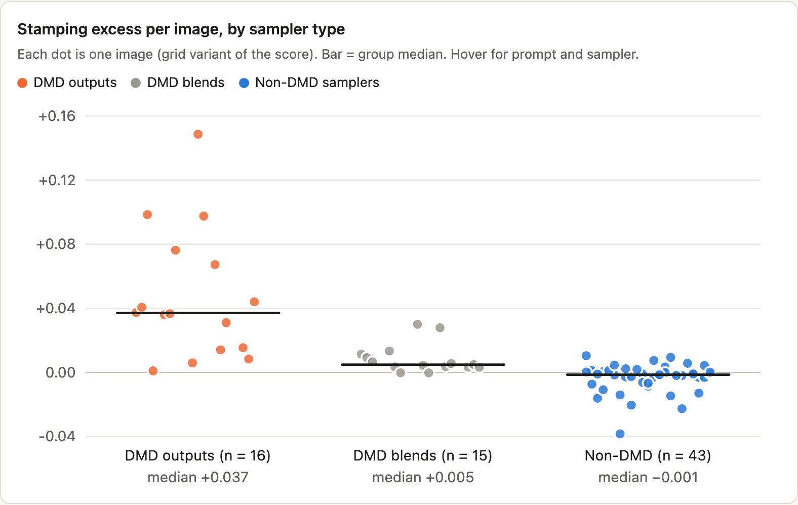

**Results:**
- **DMD vs non-DMD:** AUC 0.977 for the grid score, and 0.984 for a phase-pooled variant (two tilings offset by 7 px). Medians +0.037 vs −0.001.
- **Blends vs clean:** AUC 0.88.
- **Not a blur score:** the softest sampler (the coarse-teacher hybrid T6S2d, detail −0.055) sits in the clean group, so the score is not simply rewarding blur.
- **Caveat:** the "clean" group includes the oracle, whose last two steps (below σ 0.463) are DMD steps.

The AUCs were recomputed from `sep_rows.json` for this document and match the log.

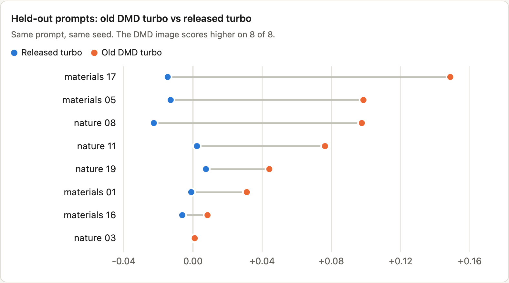

On the held-out set (same prompt, same seed), the DMD image scores higher than the released turbo's on 8 of 8 prompts.

### 7.2 Not the known first-step collapse

**The closest prior work found** is Gandikota & Bau (arXiv 2503.10637). Distilled models commit structure at their first step, which collapses diversity *across* images, and running the base model for the first step restores it.

**Stamping is different:**
- it is repetition *within* an image;
- in our data, base-model first steps do not remove it (*quality* already uses two);
- it accumulates with mid-band distilled applications, even from exact states (§4.1).

GAD (arXiv 2606.01651), on lost sensitivity to the initial noise, also does not address within-image repetition. This was a targeted search, not a systematic review.

### 7.3 The DMD student overcommits fine detail

**The probe:** at a matched state (the same latent and σ), each network's clean estimate was scored for its high-frequency share.

**At σ 0.919:**
- **The guided teacher's estimate** is still a blurry average.
- **The DMD adapter's estimate** carries far more fine detail on the two texture prompts: 1.8× the teacher's on bread, 3.1× on lichen. It commits sharp, stereotyped texture while the teacher is still undecided.
- **Our regression student** stays close to the teacher.
- **On the sign** the gap is small (1.2×).

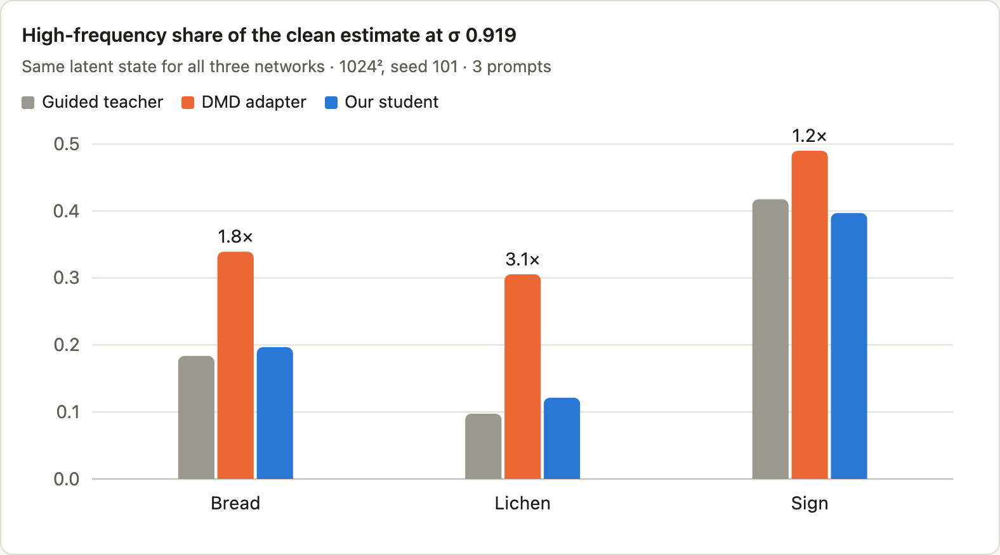

| Prompt | σ | HF share: teacher | DMD | student | Gain: teacher | DMD | student |
|---|---|---|---|---|---|---|---|
| Bread | 1 | 0.004 | 0.032 | 0.003 | 2.83 | 1.72 | 1.25 |
| Bread | 0.919 | 0.184 | 0.339 | 0.197 | 4.04 | 4.71 | 1.33 |
| Bread | 0.671 | 0.358 | 0.463 | 0.385 | 4.07 | 4.07 | 1.32 |
| Lichen | 1 | 0.004 | 0.010 | 0.003 | 2.64 | 1.55 | 1.14 |
| Lichen | 0.919 | 0.098 | 0.305 | 0.121 | 3.62 | 5.18 | 1.35 |
| Lichen | 0.671 | 0.343 | 0.451 | 0.372 | 4.15 | 4.32 | 1.36 |
| Sign | 1 | 0.005 | 0.082 | 0.006 | 2.88 | 4.20 | 1.39 |
| Sign | 0.919 | 0.418 | 0.490 | 0.397 | 5.56 | 8.40 | 2.03 |
| Sign | 0.671 | 0.525 | 0.551 | 0.527 | 5.45 | 4.96 | 1.83 |

*1024², seed 101.*
- **The states:** σ 1 is noise; σ 0.919 is reached by 15 guided Euler steps; σ 0.671 is the cached exact state.
- **Gain** = |Δx̂₀| / |δ|, for a random perturbation with |δ| = 1% of |x|.
- **The gain results are mixed for DMD.** The regression student is consistently ~3× less sensitive than the guided teacher, but CFG confounds the teacher's gain.

### 7.4 A confound we found in our own metric

**The finding:** scoring decoded intermediate clean estimates showed that `dup_frac` rates the teacher's blurry posterior means as *more* repetitive than the student's sharp ones. Bread at σ 1: teacher 0.460, student 0.242.

**What it means:**
- The score is invalid on heavily blurred images.
- The earlier claim that "the student's first estimate already stamps" (Phase C2) therefore stands on visual inspection only.
- The final-image comparisons are not affected in an obvious way: final images are not heavily blurred, and the softest sampler scored clean (§7.1). It is still a limit worth knowing.

---

### 7.5 Cross-family test: stamping does not generalize

A pre-registered test on three independent distilled families found no stamping excess. In each family, the native student scored below its own teacher: SDXL/DMD2 −.008, Qwen-Image/Lightning −.006, FLUX.1-dev/Turbo-Alpha −.013 (40 prompts × 3 seeds). Two caveats limit what that means:
- **Teacher baselines:** those teachers already score well above real photographs on this metric, so the paired comparison is weaker there than on MOSS.
- **Lightning's splices:** they add a fine lattice micro-texture of their own, a different pattern.

Full results: [cross-family-test.md](cross-family-test.md).

So 7.1–7.3 describe MOSS-Image's community DMD adapters, not few-step distillation in general.

## 8. Honest limits

- **One base model.** Everything is MOSS-Image SFT with two community DMD adapters, and the second was warm-started from the first. Whether stamping appears in other distilled families is untested.
- **Small n.** No FID or KID at scale. Specifically:
  - the dose-response rests on 3 prompts at one seed;
  - the allocation map on 7 prompts at one seed;
  - the relabel/teleport result on 16 images and a defect count of 2 vs 0;
  - the held-out set is 32 prompts at one seed;
  - the separation analysis is 74 images over 11 prompts.
- **Judges.** Visual verdicts are by the author and Felix, mostly unblinded. No human detection study shows that people see what the score measures.
- **Metric blind spots.**
  - The stamping score is calibrated for three organic materials and is phase-sensitive. It missed the seed-202 rosettes and misreads blur.
  - OCR cannot see ghosting.
  - Mean |img − ref| is dominated by legitimate composition drift.
- **Not isolated.**
  - Regression vs DMD is a whole-system comparison: DMD was never trained on our data.
  - The data mix, size and aspect ratios were never ablated.
  - The root cause inside DMD training is unknown. Candidates are reverse-KL mode seeking, CFG at every noise level, and high-noise weighting.
- **Known weaknesses of the release.**
  - Regular geometry is too organic: repetition 0.072 below the reference on 16 regular prompts.
  - Small dense text: OCR 0.957 vs 0.970 for the reference (8 prompts, seed 101).
  - Composition follows the reference only approximately.
  - Untested outside ~1 MP and the 9 trained aspect ratios.
- **Novelty.** No ingredient is new: trajectory regression, DAgger-style relabelling, teacher/student hybrid samplers, DPM-Solver++ and destripe all have precedents. What may be new:
  - the measured account of stamping;
  - the oracle-splicing method as a design tool;
  - the paired repetition score.

  "We found no paper" means exactly that.

## 9. What's next

- **Cross-family replication: done, negative** ([cross-family-test.md](cross-family-test.md)). Next is to find out *why* MOSS's adapters stamp. Candidates are their training captions, full-strength guidance at every noise level and high-noise-weighted training. Scores should also be compared with a reference that is clean on the metric (real photos per material).
- **Metric hardening:** phase-invariant features, a blur control, and a labelled human study.
- **Mechanism:**
  - which DMD training ingredient causes stamping;
  - an equal-pass-count test that varies only how many of the passes are distilled.
- **Equal-budget baselines** for the shipped sampler:
  - a tuned 15-evaluation teacher solver;
  - a DMD or consistency student trained on the same 2,000 prompts.

---

*Licensing: this document and its images are CC BY 4.0. MOSS-Image SFT (OpenMOSS) and the destripe LoRA (nynxz) are Apache-2.0.*
