# MOSS turbo v2: results and decisions

Status as of 22 October 2026. "Reference" is the original MOSS-Image SFT model at 50 steps, CFG 3 with the layer-22 skip, and the faint vertical stripes removed (destripe). How each number is computed: [how-the-numbers-work.md](how-the-numbers-work.md).

## Verdict (stage 2 checkpoint)

**The new turbo beats the previous `quality` turbo and passes every pre-registered check**, on the 18-prompt test set (two seeds) and on 32 held-out prompts never seen in training or tuning.

**How it works:**
- a trained CFG-free student (a rank-64 LoRA on the SFT weights) does most of the first half of the original model's trajectory;
- the guided original model takes over for one step at "slot 2" (σ .957 → .919), where lettering is decided;
- the original model's own 4-step DPM-Solver++(2M) finish runs last;
- destripe is applied throughout.

That's **15 network passes, about 119 s per image** at about 1 MP on an M4 Pro (8-bit tier).

**Remaining gaps:**
- occasional small-text slips;
- legitimately regular geometry rendered too organically: a chain-link fence shadow on a face, rows of washing machines;
- no time margin under 120 s.

Stage 3 (trained, under evaluation; see below) targets the first two.

## Numbers

| Measure (vs the reference) | New turbo | Previous `quality` turbo |
|---|---|---|
| Stamping excess, held-out materials and nature | −0.006 (reference level) | +0.063 |
| Stamping excess, test set seed 101 (bread / lichen / bark) | ≈ 0.00 / 0.00 / 0.00 | 0.037 / 0.017 / 0.015 |
| Fine-detail difference, held-out | −0.004 | −0.022 |
| Mean pixel difference, held-out | 0.090 | 0.124 |
| Brightness difference, held-out | +0.011 | −0.049 |
| English text (OCR character bag), held-out | 0.947 | 0.951 (reference: 0.934) |
| Chinese text, held-out | correct (checked by eye) | correct (checked by eye) |
| Time per image, 8-bit tier | ~119 s (15 passes) | ~80 s (10 passes) |
| Malformed faces, hands or ghosting | none seen (68 images) | none seen |

## Images

Each row: reference | new turbo | `quality`.

| | |
|---|---|
|  | 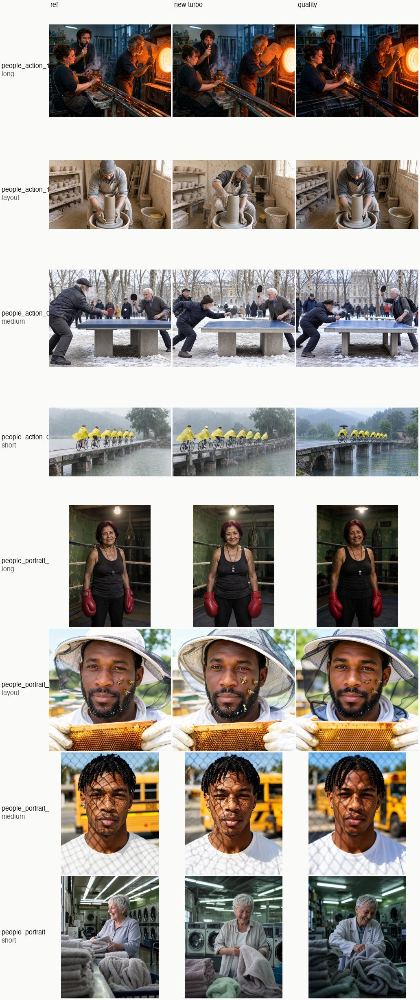 |
| Held-out materials and nature. Note the pebbles: `quality` turns them into uniform beads. | Held-out people. |
| 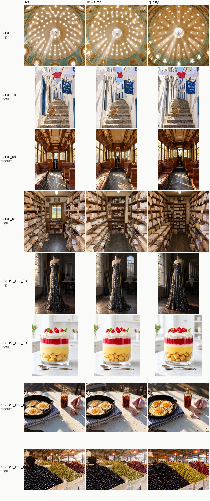 | 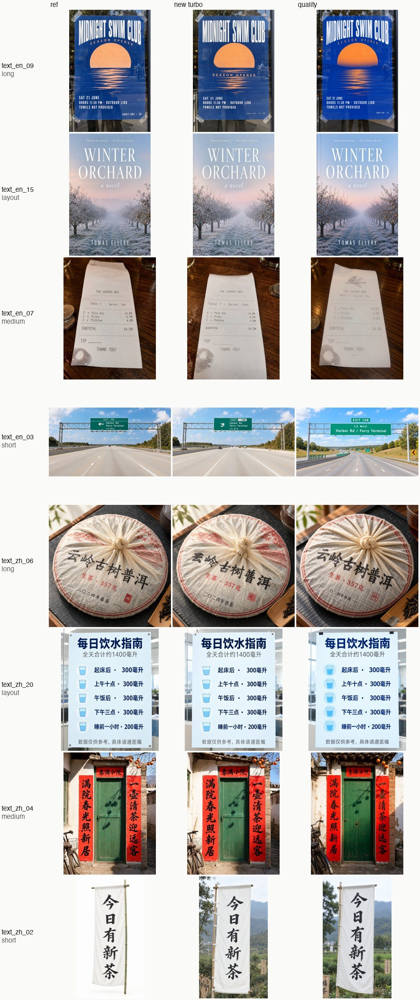 |
| Held-out places and products. | Held-out English and Chinese text. |

**Test set, seed 202:**

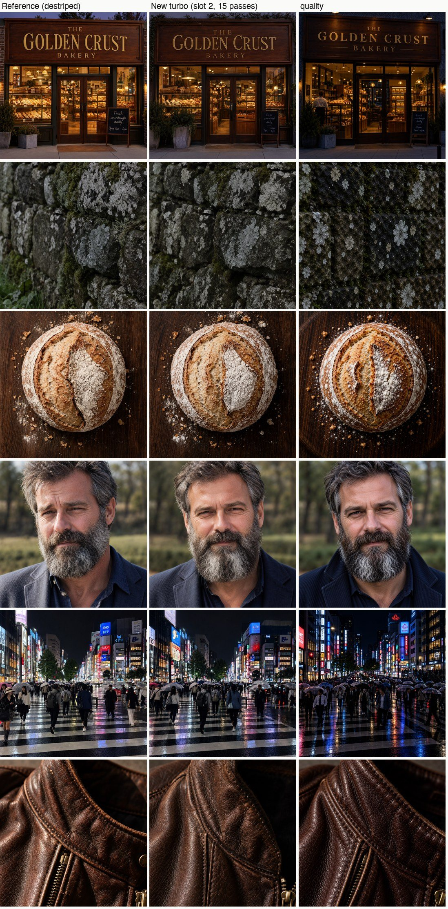

**How the slot-2 step was found.** One original-model step was placed in each of the student's 6 slots in turn. Only slot 2 fixes the headline:

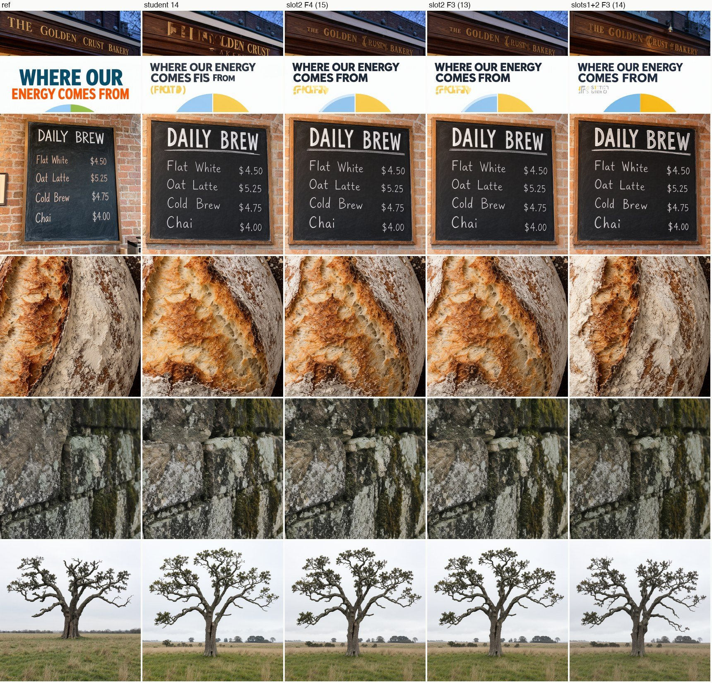

**Training targets.** Relabelled targets (left) against teleport targets (right). The teleport targets ghost:

**Background evidence** (why the original model does the finish, the error tolerance, valid-path vs averaged error, the destripe check, the original stamping problem):

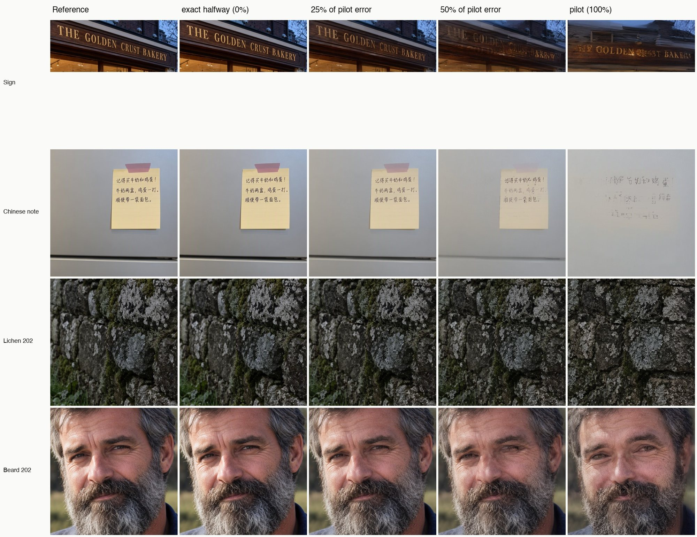

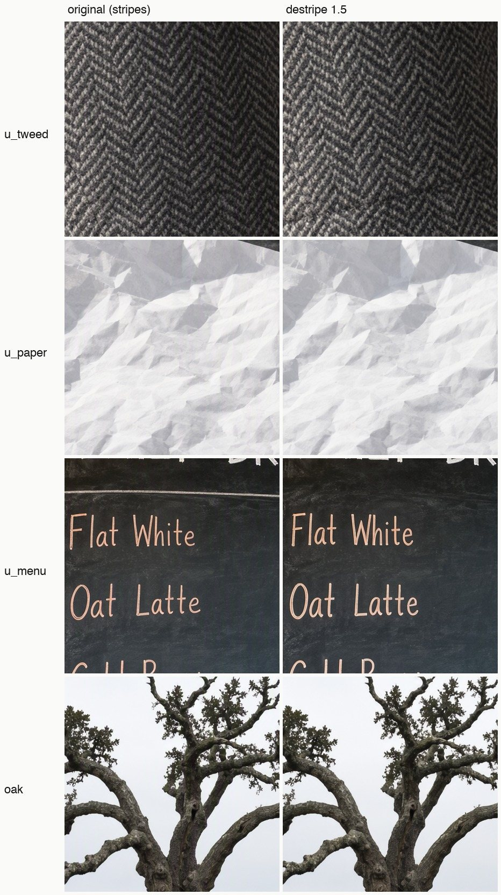
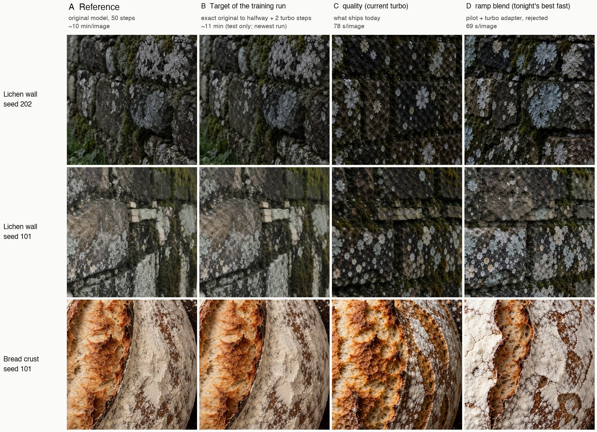

## Decisions made so far

**21 October** (project owner):
- **Target:** about 1 MP in 9 aspect ratios; at most 120 s on the 8-bit tier.
- **Look:** official settings (CFG 3 + layer-22 skip); "same character" rather than seed parity; stripes removed.
- **Spectrum** (spectral feature forecasting): not used. It can't speed up a few-step schedule, and it would perturb the teacher data.
- **Spend:** stages 1–2 approved with a ~$50 cap; actual ≈ $37.50.

**After stage 2:**
- **Training targets:** relabelled targets win (teleport targets ghost).
- **Finish:** the original model's 4-step finish. The previous turbo adapter is no longer used anywhere in the new turbo.
- **Schedule:** slot 2 only, the 15-pass version.

**22 October** (owner, after reviewing the results page):
- **Verdict:** "the new turbo is clearly better". Exceptions: fence-shadow grids and aligned washers came out too organic.
- **Small text:** fix before any release, via stage 3.
- **Stage 3:** approved with a $15 cap.
- **The previous turbo adapter:** replace it.
- **Release:** keep private for now (no weights published).

**Licenses:** MOSS-Image SFT (OpenMOSS) and the destripe LoRA (nynxz) are Apache-2.0.

## Stage 3 (trained and evaluated; stage 2 is released first)

**Training:**
- warm start from the stage-2 student;
- reuse the stage-1 teacher states (1,983 samples);
- add 259 new prompts: 140 for legitimately regular geometry (fence and mesh shadows, blinds, tiles, aligned machines, shelving, keys, chessboards, plaid…) and 119 for small or dense text, with teacher data only for these;
- oversample them 3× (existing text prompts 1.5×);
- 3,565 more iterations (stopped by the time cap). Cost $13.10 of a $15 cap.

**Evaluation:** 24 new held-out prompts (16 regular geometry, 8 small text), two seeds; plus the earlier 32 held-out prompts and the test set.

| Measure | Stage 2 | Stage 3 | Reference |
|---|---|---|---|
| Small-text OCR, seed 101 | 0.957 | 0.944 | 0.970 |
| Small-text OCR, seed 202 | 0.914 | **0.955** | n/a |
| Map prompt OCR, seeds 101 / 202 | 0.81 / 0.47 | 0.69 / 0.72 | |
| Regular-geometry repetition vs reference, seed 101 | −0.072 | −0.059 (closer) | 0 |
| Mean pixel difference, new held-out, seed 101 | 0.1012 | 0.1017 | |
| Test set, seed 101: text / stamping excess / pixel diff | 0.990 / +0.011 / 0.107 | 0.927 / +0.006 / 0.092 | |

The seed-202 run has no 50-step reference, so it compares the two stages directly.

**By eye:**
- **Better in stage 3:** the chain-link fence shadow is a cleaner diamond grid, closer to the reference; small text is slightly better on seed 202; stamping is slightly lower.
- **Worse in stage 3 on seed 101:**
  - the stadium seating warps;
  - the test-set infographic headline is garbled (OCR 1.0 → 0.75);
  - one timetable is set in smaller type.
- **On seed 202:** none of the seed-101 regressions recur.

**Owner's review (22 October):** "stage 3 is a clear improvement; the areas of improvement outnumber the regressions in quantity and intensity". The stadium warp is acceptable.

Each row: reference | stage 2 | stage 3 (seed 101).

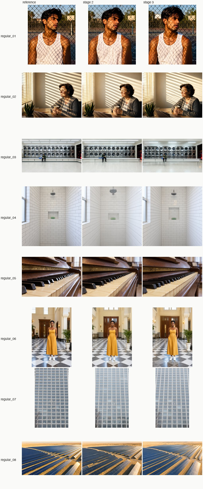
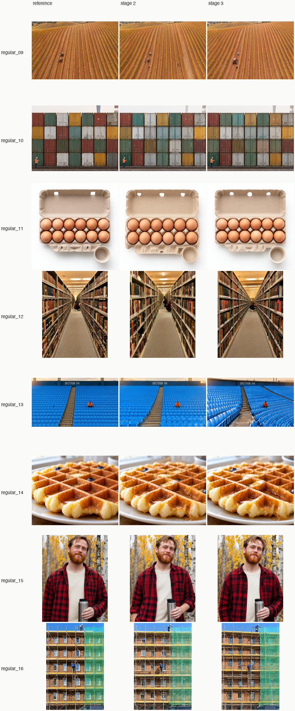
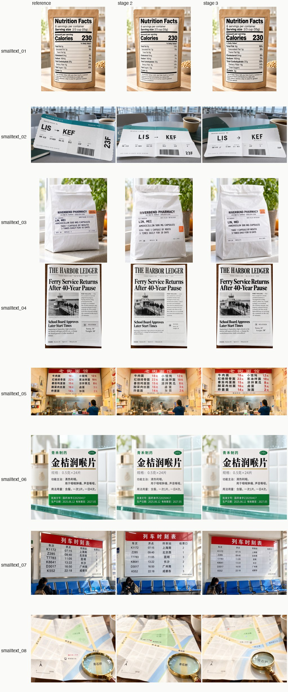

Seed 202, stage 2 | stage 3:

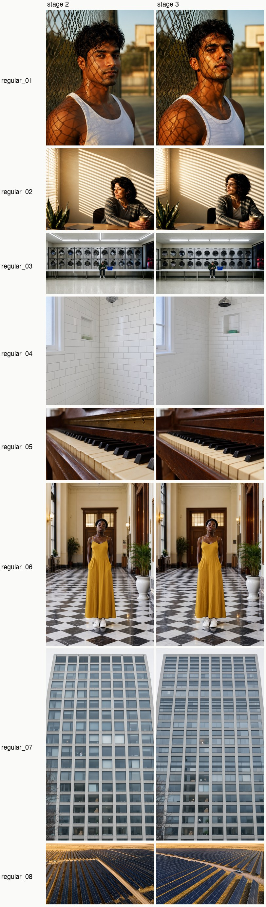
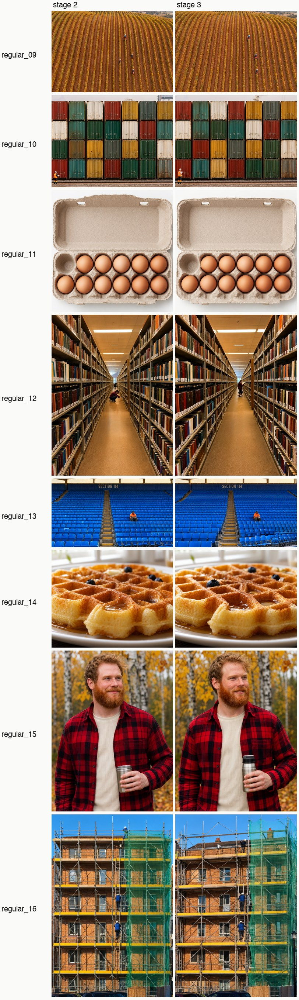
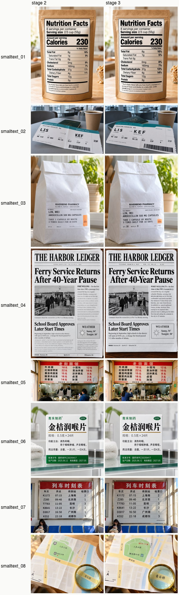

**Follow-up tests:**

| Measure | Stage 2 | Stage 3 | Reference |
|---|---|---|---|
| Earlier 32 held-out: pixel diff / brightness / stamping excess | 0.090 / +0.011 / −0.006 | 0.089 / +0.009 / −0.010 | 0 |
| Earlier 32 held-out: English text OCR | 0.947 | 0.932 | 0.934 |
| Test set, seed 202: stamping excess / sign OCR / pixel diff | +0.004 / 0.959 / 0.082 | −0.005 / 1.0 / 0.098 | |

Overall, stage 3 is about equal to stage 2, a little better on small text and stamping, with slightly more composition drift.

**Decision (22 October):** release stage 2 now as the package's `--turbo` (15 passes, ~2 min, 9.4 GB peak). The packaged sampler reproduces the research images bit for bit. Stage 3 work continues.
