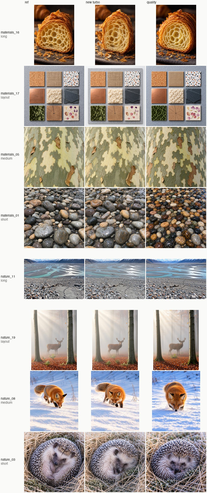
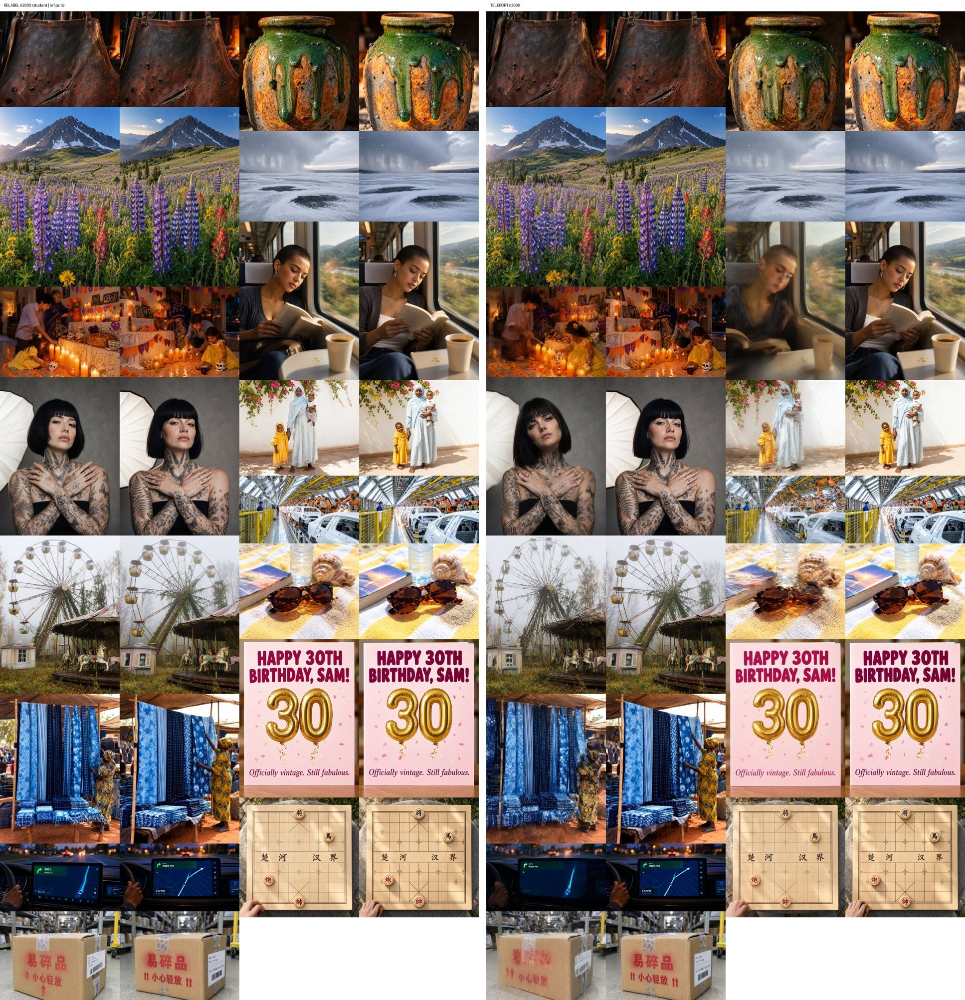
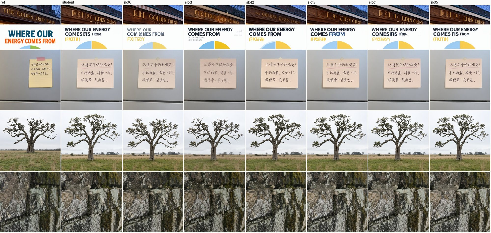

# MOSS-Image Turbo: distilling half a trajectory

*Technical write-up of the `--turbo` sampler in [moss-image-mlx](https://github.com/felix-ab/moss-image-mlx) 0.2.0, 22 October 2026.*

`--turbo` renders a ~1 MP MOSS-Image SFT image in **15 network passes**. The official recipe (50 steps, CFG 3) takes 100. On an M4 Pro that is **~119 s instead of ~12½ min (6.2×)**, at a **9.4 GB** peak (8-bit tier). It removes the stamped, repeated textures of the distilled adapters available for MOSS-Image, and it tracks the full model's own image for the same seed.

The design came from measurement, not from a known recipe. Exact intermediate states of the 50-step model were cached and used as oracles, to find which part of the trajectory a distilled network may handle and which part it may not. The result is a hybrid:

1. **A small trained student** handles only the composition half of the trajectory.
2. **One guided step of the original model** sits where lettering is decided.
3. **The undistilled original model** does the whole detail half.

This document covers:
- each design decision: why it was made, how it works, what it fixed, and how strongly the evidence supports it;
- what failed;
- what remains unproven.

The chronological lab notebook is [research-log.md](research-log.md); the metrics are defined in [how-the-numbers-work.md](how-the-numbers-work.md).

---

## 1. Result

**Setup:** 32 held-out prompts, never used in training or tuning, each at its own aspect ratio (~1 MP), seed 101, 8-bit tier.

**Reference:** the official 50-step sampler (CFG 3, block-22 skip on the negative branch), with nynxz's destripe LoRA so its faint vertical stripes are removed.

| | `--turbo` (this release) | Earlier turbo (`quality`: DMD adapter + 2 original steps) | Reference |
|---|---|---|---|
| Network passes | **15** | 10 | 100 |
| Time per image (M4 Pro, 8-bit) | **~119 s** | ~80 s | ~743 s |
| Peak memory (one image) | 9.4 GB | 9.3 GB | 9.3 GB |
| Stamped texture: DINOv2 repetition excess over the reference (materials + nature, n = 8) | **−0.006** | +0.063 | 0 |
| Fine detail: high-frequency energy vs the reference | **−0.004** | −0.022 | 0 |
| Mean \|luma difference\| from the reference image | **0.090** | 0.124 | 0 |
| Brightness difference | +0.011 | −0.049 | 0 |
| English text, OCR character recall (n = 4) | 0.947 | 0.951 | 0.934 |
| Malformed faces or hands, ghosting (manual, E + held-out, 68 images) | none seen | none seen | |

Every figure in this table is measured. The pre-registered decision rule ([m6b-plan.md](archive/m6b-plan.md)) has four parts, and the release passes all of them:
- (a) no text regression against the incumbent;
- (b) reference-anchored preference;
- (c) no new defect class in 68 images;
- (d) ≤ 120 s per image.

**How strong this evidence is:**
- **Seeds:** one seed on the held-out set, two on the 18-prompt test set E.
- **Judges:** visual checks by the author and the project owner. There was no large-scale distribution metric (FID or KID over thousands of images).



---

## 2. The problem: stamping

Community few-step adapters for MOSS-Image are trained with DMD (distribution matching). They are fast, but they produce what we came to call **stamping**: organic materials turn into repeated templates. Examples:
- lichen becomes rows of identical rosettes;
- pebbles become uniform beads;
- a bread crust becomes a lattice of lobes;
- beards become evenly curled bundles.

They also idealize content. "Weathered hands" come out young and clean, worn leather comes out glossy. And they darken the image.

**Measuring it.** Stamping was measured as the share of textured DINOv2 patch tokens whose nearest neighbour at least 56 px away has cosine ≥ 0.85 (`dup_frac`), reported as the excess over the 50-step reference for the same prompt and seed.

**Calibration** (Phase 2a), against 15 real photographs:
- **Organic materials:** for lichen, bark and bread, real photos and the reference fall in the same range (0.000–0.025). The DMD turbos sit 3–7× above it.
- **Other materials:** for crumpled paper and woven fabric the metric does not separate real photos from turbos, so those categories are excluded from every aggregate.

---

## 3. The diagnostic method: oracles from cached exact states

The most useful tool in the project was cheap.
- **Caching:** store the exact 50-step guided state at an intermediate σ.
- **Splicing:** continue from it with any other sampler.

That separates the error a component makes from the error it inherits. Four findings followed. They set the architecture.

### 3.1 Stamping is a dose-response to re-applying the distilled mapping

We started from the exact state at σ and finished with the community 8-step DMD adapter ([lodestones/MOSS-Image-SFT-8-steps-dmd](https://huggingface.co/lodestones/MOSS-Image-SFT-8-steps-dmd), strength 0.7). The more adapter steps remain above σ ≈ 0.67, the more stamping appears (1024², seed 101; bread / lichen / bark):

| Exact 50-step state to σ | DMD-adapter steps after it | Repetition excess | Mean luma (reference 0.458) |
|---|---|---|---|
| 0.926 | 6 | 0.055 / 0.010 / 0.024 | 0.434 |
| 0.671 | 3 | 0.017 / 0.004 / 0.004 | 0.445 |
| 0.463 | 2 | 0.011 / 0.001 / 0.003 | 0.452 |

**What the table shows:**
- **The entry point does not matter.** Starting from a perfect σ 0.926 state still stamps, so a better entry point cannot fix stamping. A more accurate 3–4-eval guided prefix to 0.926 also failed to reduce it (Phase 5f).
- **Darkening behaves the same way:** each adapter application darkens the image a little more.

**A coarser, confounded version** (768², the configurations also differ in their teacher prefixes) shows the same order. Repetition excess is 0.079 for 8 adapter steps, 0.043 for 6, 0.033 for 4, 0.024 for 3, 0.019 for 2 and 0.000 for 0.

**Corroborating evidence:**
- **The mechanism, by matched-state probes** (Phase 2b): at the same latent and σ 0.97–0.79, the adapter's clean estimate carries **1.5–5×** the high-frequency latent energy of the guided teacher's. The distilled network commits sharp detail where the teacher is still undecided.
- **Decoded traces** (Phase C2): the stamped morphology already appears in the student's *first* clean estimate, and each later application reinforces it.

**Prior work.** This matches a failure Ahn et al. describe for repeated correction ("overly coherent structures … strawberry seeds arranged in a regular grid", Correction Training, arXiv 2610.14136). Our contribution here is only a measurement of it, in this model, from exact states.

**What it decided:** no distilled step may run in the mid-σ band (~0.93 → 0.46), where texture is organized.

**Supporting negative result: it is not quantization.** The same adapters on the bf16 checkpoint give the same stamped morphology, with `dup_frac` within ±0.01 (Phase 1a).

### 3.2 The finish does not need distilling: the original model's DPM-Solver++(2M) suffices

From the identical exact state at σ 0.463, finishes were compared on 7 images:

| Finish from the exact σ 0.463 state | Passes | Mean \|img − ref\| | Repetition excess (5 items) | Detail Δ | Luma Δ |
|---|---|---|---|---|---|
| DMD adapter, 2 steps | 2 | 0.0218 | up to +0.016 | −0.029 | −0.008 |
| DMD adapter, 3 steps | 3 | 0.0187 | up to +0.010 | −0.006 | −0.006 |
| Original model, 1 step + adapter 1 step | 3 | 0.0101 | up to +0.009 | −0.028 | −0.004 |
| Original DPM++(2M), 2 evals | 4 | 0.0087 | up to +0.009 | −0.033 | −0.002 |
| **Original DPM++(2M), 3 evals** | **6** | **0.0047** | **≤ 0** | **+0.006** | **+0.001** |
| Original DPM++(2M), 4 evals | 8 | 0.0044 | (not recorded) | | |

**What the table shows:**
- **Fidelity:** the 3-eval original finish is **4.6× closer to the reference** than the distilled 2-step finish.
- **Saturation:** a 4th eval adds almost nothing (0.0044 vs 0.0047), so extra budget belongs in the prefix.
- **Earlier handoff:** from an exact state at σ 0.671, a 4-eval finish (σ .671 → .536 → .373 → .193 → 0) is equally faithful: 0.0051 vs 0.0053 for the .463 handoff in the same run.

**Why this matters:** the remaining problem was entirely the prefix, and the prefix needs only ~6 steps.

### 3.3 The *kind* of prefix error matters more than its size

**Error budget.** The exact state was mixed with an imperfect student state (x = (1 − α)·exact + α·student) and then finished with the original model:

| α (≈ relative state error) | Mean \|img − ref\| | Visual |
|---|---|---|
| 0.25 (≈ 0.10) | 0.025 | indistinguishable from exact |
| 0.50 (≈ 0.20) | 0.054 | **ghosting**: doubled sign letters, double eyes |
| 1.0 (≈ 0.40) | 0.106 | ghosted sign, illegible note |

**Comparison with coherent error.** A chained 8-step guided Euler rollout reaches σ 0.463 with a *larger* relative state error (0.32–0.51) and a similar image difference (0.106). It produces **no ghosting**: a legible sign and coherent lichen, but darker (luma −0.051) and softer.

**What this shows:**
- **Coherent error is tolerable:** a valid but different flow gives a plausible, slightly different image.
- **Averaging error is not:** a superposition of two solutions ghosts even when it is small.
- **Practical consequences:**
  - relative state error is a poor training target and validation signal;
  - validation had to happen in image space;
  - the choice of training targets became the central question (§4.3).

**Caveat:** linear mixing creates double exposures by construction. So this budget measures *averaging-type* error exactly, and it overstates the harm of coherent drift.

### 3.4 Where the trajectory is curved, and where to hand off

**Measure.** One guided Euler jump from the exact state was compared with the exact end of each interval.

**Result.** On the release grid, the last interval before σ 0.463 (σ .671 → .463) has a single-jump error of 0.048–0.050, vs 0.015–0.018 for the first interval. On a uniform 8-step grid the error grows toward the end, to 0.028–0.029 for the last interval (.623 → .463). A 6-step grid that stops at .671 stays at 0.004–0.024 throughout.

**Decision.** The student ends at **σ 0.671 (50-grid index 35)**, before the curved section. That leaves the curved section to the original model.

**Supporting facts:**
- the handoff costs nothing in finish fidelity (§3.2);
- it saves ~17% of teacher compute (35 of 50 steps stored rather than 42).

---

## 4. The design, decision by decision

The sampler, per image:

| Segment | σ | Who | Passes |
|---|---|---|---|
| Student steps 0–1 | 1 → .983 → .957 | trained student, no CFG | 2 |
| **Slot 2** | .957 → .919 | **original model, CFG 3 + block-22 skip** | 2 |
| Student steps 3–5 | .919 → .871 → .791 → .671 | trained student, no CFG | 3 |
| Finish | .671 → .536 → .373 → .193 → 0 | original model, DPM-Solver++(2M), CFG 3 | 8 |
| Throughout | | destripe LoRA (nynxz) at 1.5 | — |

The student's σ points are 50-grid indices 0, 4, 9, 15, 21, 28, 35. The guided steps use the official settings.

**How well-isolated each decision's evidence is:**
- **Isolated:** a clean ablation (only this changed).
- **Supported:** consistent measurements, but with confounds or small n.
- **Unablated:** a reasoned choice, never tested on its own.

### 4.1 Distil only the composition half (σ 1 → 0.671) · *Isolated (oracle)*

- **Motivation:** §3.1 and §3.2. Stamping is caused by distilled steps in the mid-σ band, and the original model already finishes faithfully from an exact mid-trajectory state.
- **How it works:** the student is trained only on σ 1 → 0.671. Everything below runs the unmodified model.
- **What it solved:**
  - it removes the distilled network from the band where stamping forms;
  - it shrinks the learning problem to 6 steps of one trajectory segment.
- **The ceiling:** the oracle (exact state + original finish) is visually indistinguishable from the reference on two seeds (Phases 4e, 5g, 6b).
- **What remains to measure:** how close the student gets to that ceiling (§4.3–4.5).

### 4.2 Regress onto the teacher's own trajectory, CFG-free · *Supported, not ablated against DMD*

- **Motivation:** the goal was to stay as close as possible to the original model's own image for the same seed. Distribution matching (DMD) rewards any sample the teacher finds plausible, and it is mode-seeking, which fits the idealization and stamping in §2.
- **How it works:**
  - **Objective:** velocity MSE onto the guided teacher's stored 50-step states, ‖v_θ(x_k, σ_k) − (x\*_{k+1} − x_k)/Δσ_k‖², with no adversarial or distribution-matching term.
  - **The student:** a rank-64 LoRA on all 252 attention and FFN projections of the 42 blocks, evaluated without CFG. One pass per step instead of two; CFG is learned implicitly.
- **What it solved:**
  - the student stamps no more than the reference;
  - it tracks the reference's composition;
  - it costs 1 pass per step.
- **Measured:** the student-only pipeline on E (18 prompts, seed 101) against the incumbent DMD-based turbo:

  | Measure | Student-only pipeline | Incumbent DMD-based turbo |
  |---|---|---|
  | Repetition excess | 0.012 | 0.066 |
  | Detail Δ | −0.009 | −0.025 |
  | Mean \|img − ref\| | 0.098 | 0.145 |
  | Luma Δ | +0.037 | −0.080 |

- **Not isolated:** this compares two whole systems with different data, objectives and authors. We never trained DMD on our data, so the gain cannot be attributed to the objective alone.
- **Open at high noise:** whether a CFG-free student can emulate CFG there is only partly answered. Step 0 had the highest loss in the pilot (5–8× the later steps), and slot 2 (§4.5) is still needed for lettering.

### 4.3 Relabelled on-policy targets instead of "teleport" targets · *Isolated (one controlled ablation)*

**The technique that mattered most for image integrity.**

**The problem.** A student trained only on teacher states (teacher forcing) meets its own drifted states at inference (exposure bias). The standard fix is to train on the student's own rollout states. That raises a question: what is the right target at a state the teacher never visited?

**Teleport** (used in our pilot): v = (x\*_{k+1} − x̂_k)/Δσ, the velocity that jumps back onto the stored trajectory.
- This field is generally not a valid flow.
- From nearby drifted states it points to the same target. The MSE-optimal response to such conflicting targets is an *average*.
- §3.3 shows averaging is exactly the error type that ghosts.

**Relabel** (released): v = (T(x̂_k) − x̂_k)/Δσ.
- T runs the guided teacher from the student's own state over the same 50-grid substeps (4–7 guided Euler steps).
- The target is the true flow *from where the student actually is*. It is the DAgger idea (query the expert on the learner's own states, Ross et al. 2011) applied to trajectory distillation.
- It accepts coherent drift, which is harmless (§3.3). It also matches the owner's stated preference for "same character" over pixel-exact seed parity.

**Controlled ablation.**
- **Setup:** two arms on two GPUs with identical data, sampling order (same RNG seed, identical draw sequence), hyperparameters and schedule:
  - rank 64, AdamW at lr 1e-4, batch 1;
  - 2,000 iterations;
  - own-rollout probability ramped 0 → 0.5 over iterations 500–1,000;
  - cosine decay after 1,000.
- **Only the target for own-rollout states differs.**

| it 2000 | Relabel | Teleport |
|---|---|---|
| Image metric (mean \|luma − ref\|, 16 val prompts) | 0.090 | 0.088 |
| State relative error at σ 0.671 (32 val) | 0.184 | 0.179 |
| Loss on own-rollout states | 0.07 | 0.92 |
| Later-step losses (steps 2–5) | 0.02–0.08 | 0.40–0.55 |
| Visible defects in the 16-image validation sheet | **none seen** | **2**: a ghosted double-exposure face; garbled Chinese characters |
| Training wall time (A100) | 138 min | 100 min |



**What it shows:**
- **The scalar metrics cannot tell the arms apart.** The image metric's noise between arms is ±0.005–0.01, and the composition-dominated metrics move together.
- **The defect check can.** The defects in the teleport arm are the type §3.3 predicts.
- **Cost:** relabel runs the teacher online, which makes training ~1.4× slower.

**Limits of the evidence:**
- one seed and n = 16 validation images per arm;
- the defect count is small;
- the pilot (teleport targets, 768², 221 samples) showed the same signature (a double-exposure face, ghosted letters), but it is confounded with other differences.

### 4.4 Validate and select checkpoints in image space, after the real finish · *Supported (with a stated limit)*

- **Motivation:** §3.3 showed that state error is a poor proxy. Relative state error at the handoff fell only from 0.216 (untrained) to 0.184 (trained), yet the images changed from "washed out, wrong compositions, garbled text" to close matches.
- **How it works:** every 500 iterations, the trainer runs the full inference path on 16 validation prompts (student rollout → original 4-eval finish → VAE decode). It scores the result against the destriped 50-step reference and uploads a side-by-side sheet. The best checkpoint is chosen by this image metric.
- **Measured:** the image metric fell from 0.118 to 0.090, and the sheets made the relabel/teleport decision possible.
- **Limit:** mean luma difference is dominated by legitimate composition drift. It could not separate the two arms, so the sheets (human inspection) were decisive. A ghosting-sensitive automatic metric remains an open need.

### 4.5 One guided original-model step at slot 2 · *Supported (allocation map, 7 prompts, 1 seed; confirmed on held-out)*

- **Problem:** the plain student (14 passes) ghosted one large headline ("THE GOLDEN CRUST BAKERY" with doubled letters) and garbled an infographic title.
- **Method:** instead of guessing where to spend one extra guided step (2 passes), we measured it. The step replaced each of the student's 6 intervals in turn (Phase 8j):

| Guided step at | Interval (σ) | Headline | Infographic title | Repetition (bread / lichen / oak) | Luma Δ |
|---|---|---|---|---|---|
| (none, student only) | | ghosted | garbled | .003 / −.001 / .040 | +.029 |
| slot 0 | 1 → .983 | ghosted | — | .007 / .001 / .031 | +.009 |
| slot 1 | .983 → .957 | ghosted | **fixed** | .002 / −.001 / .019 | −.009 |
| **slot 2** | **.957 → .919** | **fixed** | **fixed** | −.002 / −.002 / .035 | +.015 |
| slot 3 | .919 → .871 | ghosted | — | .002 / −.001 / .040 | +.028 |
| slot 4 | .871 → .791 | ghosted | — | .001 / −.003 / .048 | +.029 |
| slot 5 | .791 → .671 | ghosted | — | .002 / −.002 / .049 | +.029 |

— = not recorded for that slot (the log notes the headline only).



**What it shows:**
- **Large-glyph identity is settled in a narrow early band, around σ 0.96 → 0.92.** That is consistent with Phase 5d: from an exact state at σ 0.926, layout and lettering already match the reference.
- **One accurate step there repairs it without reintroducing stamping.**
- **OCR missed it:** the OCR character-recall metric scored 0.990 both with and without the fix, because it cannot see ghosting. The verdict here is visual.

**Confirmation:**
- slot 2 + 4-eval finish (15 passes) kept the headline correct on seed 202 (Phase 8l);
- it passed the full held-out check (§1).

**Alternatives tested:**
- adding slot 1 as well, with a 3-eval finish: darker, and lost detail (−0.027);
- slot 2 with a 3-eval finish (13 passes, ~104 s): detail −0.017 vs −0.003. That is the fallback if 15 passes is too slow.

**Weaknesses:**
- the map comes from 7 prompts at one seed;
- the slot-2 benefit rests on 2 text prompts with visible failures.

### 4.6 Destripe in the teacher, the student and the reference · *Isolated for side effects*

- **Problem:** the SFT checkpoint shows faint vertical stripes. Teacher-heavy samplers inherit them (stripe score 26.4 on the oak sky for an original-model-heavy schedule vs ≤ 13 for the DMD turbo).
- **How it works:** nynxz's LoRA removes the top 64 stripe-attributed SVD directions of the Base→SFT delta. Applied at 1.5, it is:
  - merged into the teacher when generating training data;
  - kept on in every inference pass;
  - applied to the 50-step references, so fidelity is measured against a destriped target.
- **Measured on E** (18 prompts, 50-step references):
  - stripe score: mean 13.9 → 5.2 (e.g. tweed 29.1 → 1.5);
  - mean \|Δimg\| 0.018 and luma +0.001;
  - repetition unchanged (≤ +0.0015);
  - high-frequency energy −0.0067, which visual inspection attributes to the stripes themselves.

### 4.7 Training data: 1,998 prompts at ~1 MP in 9 aspect ratios · *Unablated*

- **Motivation:** the pilot was trained at 768² and served at 1024²; it broke text, with the Chinese note illegible and the sign garbled. The owner also asked for unusual care with prompts.
- **How it was built:**
  - 8 domain writers × 250 prompts, matched to MOSS's own caption schema (long, medium and short captions, plus official JSON layouts compiled with OpenMOSS's `compile_prompt.py`);
  - 41.5% text (English 26%, Chinese 13%, bilingual 3%);
  - 9 aspect ratios (768×1360 to 1360×768);
  - exact and near-duplicate removal;
  - a leakage check against every evaluation prompt (shared visible strings of ≥ 16 Latin or ≥ 5 CJK characters).
- **The teacher run:** 1,983 samples (1,919 train / 64 val) in 7.4 h on 2× A100.
- **Notably small run:** the released student saw only **2,000 (state, step) training examples** (batch 1). That is about one visit per sample.
- **Evidence:** none for the size, composition or aspect mix on their own. The pilot comparison is confounded (resolution, sample count and target type all changed). The plausible reading, that serving resolution must match training resolution, is unverified.

### 4.8 Engineering: unmerged fp32 LoRA over an 8-bit base, adapter groups · *Verified*

- **The student is never merged.** It runs as an fp32 low-rank path beside the 8-bit quantized transformer, so quantization does not round the small distillation delta away.
- **Two adapter groups:** destripe (always on) and the student (switched per step) can be enabled independently in the MLX implementation.
- **Verification:**
  - the packaged sampler reproduces the research sampler bit for bit (3 held-out prompts, maximum pixel difference 0);
  - single-image peak is 9.41 GB, vs 9.31 GB for the 50-step path on the same tier.
- **Untested:** the bf16 and compact tiers with `--turbo`.

---

## 5. How much each piece contributed

We did not run a full factorial ablation, so the contributions below are not additive. Each row cites the narrowest comparison we have.

| Decision | Problem addressed | Best evidence of effect | Strength |
|---|---|---|---|
| Distil only σ 1 → 0.671 | stamping from distilled mid-σ steps | Exact-state + DMD steps: repetition (bread) 0.055 → 0.017 → 0.011 as adapter steps go 6 → 3 → 2; oracle ≈ reference | Isolated (oracle) |
| Original-model finish (DPM++(2M), 4 evals from .671) | finish-induced stamping, darkening | \|img − ref\| 0.0218 → 0.0047 (4.6×) from identical exact states | Isolated |
| Trajectory regression, CFG-free student | idealization, stamping, CFG cost | Student pipeline vs DMD turbo on E: repetition 0.012 vs 0.066; \|d\| 0.098 vs 0.145 | Whole-system comparison, not isolated |
| Relabelled on-policy targets | ghosting (averaging error) | 0 vs 2 visible defects in 16 val images; scalar metrics equal | Isolated, small n |
| Handoff at σ 0.671 | curvature near 0.6 → 0.46; teacher cost | Equal finish fidelity (0.0051 vs 0.0053); −17% teacher steps | Isolated (oracle) |
| Slot-2 guided step (+1 pass, ~7 s) | ghosted large lettering | Only slot that fixes both headline and title (7 prompts); held on seed 202 and held-out | Supported, small n |
| Destripe throughout | inherited SFT stripes | Stripe score 13.9 → 5.2; side effects ≤ 0.018 \|Δ\| | Isolated |
| Image-space validation | proxy metric blind to failures | Made the target-type decision possible; can't separate arms numerically | Process, qualitative |
| 1,998 prompts, 9 aspects at ~1 MP | resolution mismatch, text coverage | None isolated | Unablated |
| Unmerged fp32 LoRA on 8-bit base | delta lost to rounding when merged | Bit-exact parity; +0.1 GB peak | Verified (implementation) |

**Speed.** All of the 6.2× wall-clock gain comes from evaluating 15 passes instead of 100: 5 student passes, 2 guided passes at slot 2 and 8 finish passes. Per-pass cost is unchanged (~7.8 s at ~1 MP).

---

## 6. What did not work

These are kept because each one either ruled out a cheaper design or explains why the final one looks as it does.

**Fixes to the DMD adapter itself (M5, M6):**

| Attempt | Outcome |
|---|---|
| More steps, other strengths or shifts | Waxier or unchanged (e.g. strength 1.0: in-focus detail −0.24 vs −0.17) |
| Stochastic re-noising | Some pore detail, motifs unchanged |
| Attenuating the adapter's rear blocks | Matte glazes on 4 prompts; did not generalize to 7 (leather, freckles got softer) |
| The adapter's native data-space sampler | Half the repetition, but the waxiest result |
| Removing regularity-attributed adapter SVD directions (nynxz's method, turned on our artifact; top 3 to top 1,024) | Repetition 0.043 → 0.038–0.044, visually identical. Stamping is not carried by a sparse set of directions this gradient finds |

**Training-free hybrids:**

| Attempt | Outcome |
|---|---|
| Original-model-only DPM++(2M), 7 evals (14 passes) | No stamping (excess 0.000), but text collapsed (English OCR 0.35, Chinese 0.00) |
| Original model with DPM++(2M) to σ .463 + 2 DMD steps (T6S2) | Stamping 0.019 vs 0.043, but on 10 held-out prompts it was hazier and ghosted small figures. Blind 2 wins vs 4 for the incumbent (3–2–5 once references were consulted). Final-latent detail 8–10% below the reference |
| Lower teacher CFG (2) | Less idealization, garbled sign |
| A better guided prefix to σ .926 | Did not reduce stamping (§3.1) |
| Blending the pilot and DMD adapters in one pass (fixed λ, or ramped) | Fixed tone; introduced malformed faces and stray text, failing rule (c) |
| Guided steps *before* the pilot student | Worse (text 0.65); off-distribution states for the student |
| "Base-anchored" finish (from Correction Training) | Identical to without |

**Training:**
- **Teleport targets:** ghosting, both in the pilot and in the controlled ablation (§4.3).
- **The pilot:** 768², 221 samples, teleport targets. It removed stamping (lichen, bark and bread ≈ 0), but broke text at 1024².

**Not adopted:**
- **Spectrum** (training-free feature forecasting, arXiv 2603.01623). It needs many small steps to fit a forecast, so it cannot help a 15-pass sampler. The owner chose not to use it on the teacher data either.
- **Stage 3 continuation training:**
  - **Setup:** +259 prompts for regular geometry and small text, 3,565 more iterations, $13.10.
  - **Better:** small text on a second seed (OCR 0.955 vs 0.914) and slightly less stamping.
  - **Worse:** more composition drift; one regression on a single seed (a garbled infographic headline).
  - **Overall:** the 32 earlier held-out prompts came out about equal.

  The owner chose to release stage 2 and keep working on stage 3.

**Operational lessons:**
- **Account balance:** a pod launched without checking the balance was stopped mid-run.
- **Pod guard:** a cost guard treated a local DNS outage as a dead pod.
- **Launch loop:** a parsing bug started duplicate pods.

None of these affected the results. Each led to a guard or check now in the tooling (`pod_guard_v3.py` and balance checks in `pod_launch.py`).

---

## 7. What remains unproven

**Effects and alternatives never isolated:**
- **DMD vs regression:** we never trained DMD on our data, so the claim that regression beats distribution matching here is about whole systems, not the objective.
- **The data:** the prompt set, its size and the multi-aspect training were never ablated.
- **The CFG-free student at high noise:** how well it emulates CFG there is not characterized beyond the step-0 loss and the slot-2 result.

**Sample sizes:**
- **Seeds:** most comparisons use 1–2 seeds and 7–32 prompts.
- **Ablation size:** the relabel/teleport result rests on 16 validation images and a defect count of 2 vs 0.
- **Distribution metrics:** no FID or KID at scale.

**Metric blind spots:**
- **OCR** cannot see ghosting.
- **DINOv2 repetition** is calibrated only for organic materials (lichen, bark, bread).
- **Mean \|img − ref\|** is dominated by legitimate composition drift.
- **Visual judgements** were made by the author and the project owner, mostly unblinded. One earlier blind test (12 of 16 for `quality` over the plain DMD turbo, sign test p = 0.0065) had a judge familiar with the styles.

**Generality (tested after release):** a pre-registered test on SDXL/DMD2, Qwen-Image/Lightning and FLUX.1-dev/Turbo-Alpha found that the distilled students do not repeat texture more than their teachers ([cross-family-test.md](cross-family-test.md)). So everything in §2–§3 about stamping describes MOSS-Image's community DMD adapters, not distillation in general.

**Known weaknesses of the release:**
- **Regular geometry:** legitimately regular structure (a chain-link fence shadow, rows of washing machines) is rendered too organically. The anti-stamping student also averages away true periodicity. Measured on the 16-prompt regular-geometry set: repetition 0.072 *below* the reference.
- **Small dense text:** OCR 0.957 vs 0.970 for the reference (8 prompts, seed 101); 0.914 on seed 202.
- **Composition:** it follows the reference for the same seed only approximately.
- **Untested settings:** sizes outside ~1 MP and the 9 trained aspect ratios; the Base checkpoint.

---

## 8. Reproducing it

**Inference** (released):

```bash
pip install moss-image-mlx
moss-mlx "A highway LED sign at sunset that reads \"HELLO MLX\"" --turbo -o sign.png
```

**Training recipe** (PyTorch, official MOSS-Image code, SFT @ `fc5de0d`; destripe nynxz @ `7b071d5`, strength 1.5, merged):

1. **Teacher** (`pod_v2/teacher.py`):
   - official guided sampler: 50-step Euler on the shift-5 grid, CFG 3, block-22 skip on the negative branch;
   - one sample per prompt at its own size, seed 10,000 + index;
   - every 50-grid state up to index 35 stored in fp16;
   - validation prompts continued to σ 0 and decoded as references.
2. **Student** (`pod_v2/train.py`):
   - LoRA rank 64 / alpha 64 on all 252 projections, frozen bf16 base;
   - AdamW (lr 1e-4, betas 0.9/0.99, no weight decay), gradient clip 1.0, batch 1, 2,000 iterations, cosine decay to 0.1× after iteration 1,000;
   - a random student step k per iteration on grid indices {0, 4, 9, 15, 21, 28, 35};
   - own-rollout states with probability 0 → 0.5 (warm-up 500, ramp 500);
   - relabelled targets via the guided teacher over the 50-grid substeps of interval k;
   - image validation every 500 iterations; best checkpoint by image metric.
3. **Inference:** grid as in §4; DPM-Solver++(2M) data-prediction multistep, first step first-order, final step to σ 0 = the last clean estimate.

**Compute:**
- stage 1, 7.4 h on 2× A100-80GB;
- stage 2, 2.3 h on 1× A100 (the teleport arm ran in parallel on the second GPU);
- ≈ $35.5 on RunPod for both stages.

**Code, configs and evidence:**
- training code: `pod_v2/` in the research workspace;
- prompt specification: [prompt-spec.md](prompt-spec.md);
- every measurement in this document, with its phase number: [research-log.md](research-log.md).

**Not yet published:** the training code and prompt files (they live in the private research workspace).

---

## 9. Relation to prior work

**None of the individual ingredients is new:**
- trajectory-regression distillation (Luhman & Luhman 2021; progressive distillation, Salimans & Ho 2022);
- training on the learner's own states with expert relabelling (DAgger, Ross, Gordon & Bagnell 2011; exposure-bias work in diffusion);
- DPM-Solver++ (Lu et al. 2022);
- mixing teacher and student steps in one schedule;
- destripe by SVD direction attribution (nynxz).

**DP-DMD** (arXiv 2602.03139) also regresses to the guided teacher for its first step and uses DMD later. Our student is the regression half, extended to six steps, with the finish left undistilled.

**What may be specific to this work** (we did not do a systematic literature search, so treat this as a description, not a novelty claim):
1. **Using cached exact teacher states as oracles** to locate, quantitatively, where a distilled mapping may act. This produced the dose-response, finish and handoff measurements, and the design followed from them.
2. **The "kind, not size" error measurement** (§3.3), and using it to choose relabelled over teleport targets for on-policy trajectory distillation, confirmed in a controlled ablation.
3. **A measured allocation of a single guided original-model step inside a student rollout** (§4.5), which places large-glyph formation in a narrow band (σ ≈ 0.96–0.92) for this model.
4. **The combination:** partial-trajectory student + undistilled DPM-Solver finish + destripe throughout. It gives a 6.2× faster sampler that tracks the reference image rather than the reference distribution.

---

*Licensing: this document and its images are CC BY 4.0. MOSS-Image SFT (OpenMOSS) and the destripe LoRA (nynxz) are Apache-2.0. The student weights are licensed under Apache-2.0.*
