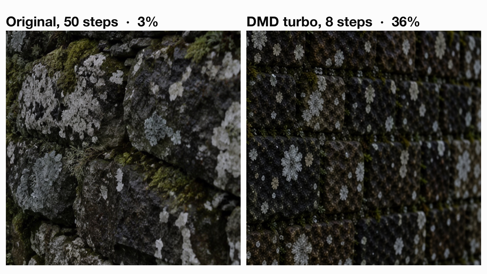
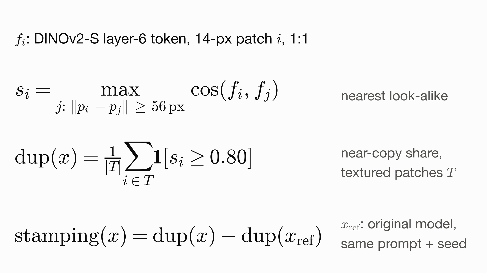
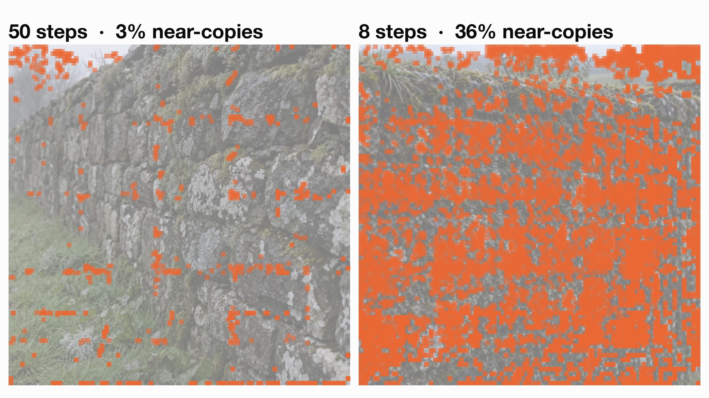
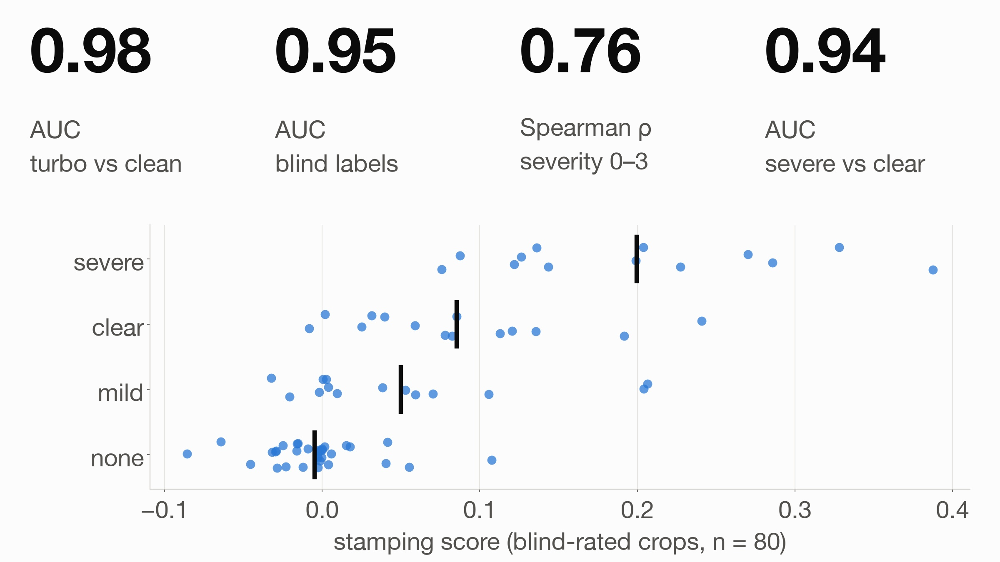
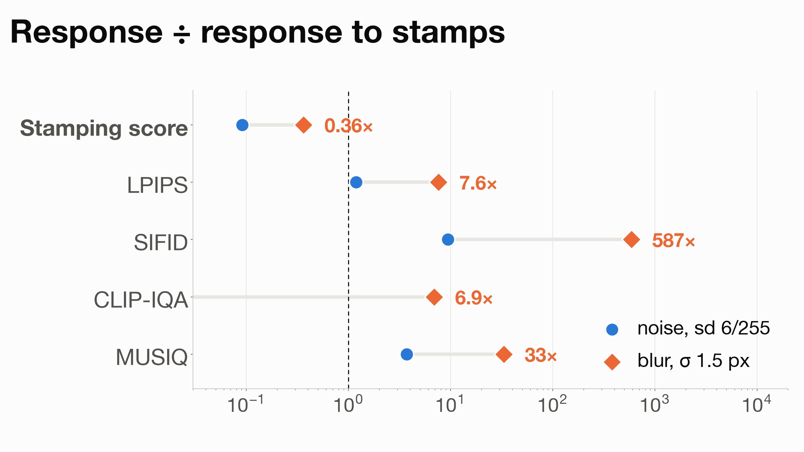
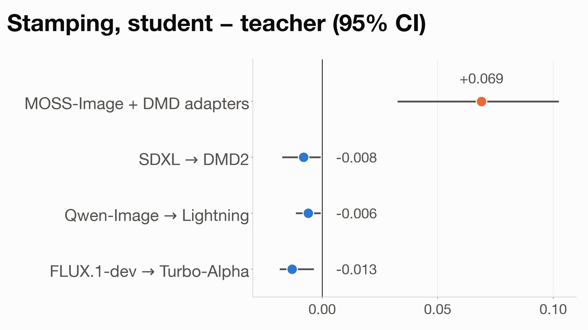

# stampscore: measuring "stamping" in generated images

**Stamping** is one small texture motif copy-pasted as near-copies across a generated image: lichen turning into
rows of near-identical rosettes, pebbles into beads, bread crumb into a lattice. The community DMD turbo adapters
for MOSS-Image do it heavily. FID, LPIPS and no-reference IQA scores mostly don't see it.

`stampscore` scores it. It was used to design the `--turbo` sampler in this repo (see [`../turbo`](../turbo/README.md)).


*Same prompt and seed. Left: MOSS-Image, 50 steps. Right: a community DMD turbo adapter, 8 steps. The % is the
share of textured patches with a near-copy elsewhere in the image.*

## How it's scored



1. Cut the image into 14×14-px patches at native resolution and describe each one with DINOv2-small (hidden layer 6,
   whose features capture texture; the last layer calls all lichen repetitive). The tiling is repeated at 7-px
   offsets and pooled, so copies misaligned with the patch grid still match.
2. Keep textured patches only (14-px luma sd > 0.02; sky and flat walls drop out).
3. For each one, find its most similar patch at least 56 px away, so its own surroundings can't count.
4. `dup_frac` = share of textured patches whose match has cosine ≥ 0.80.
5. **`excess` = `dup_frac` − the same share for a clean reference** (same prompt and seed, the original many-step
   model). Some scenes really are repetitive (bricks, weave); the reference cancels that. 0 means no more repetition
   than the original.

A guard compares detail bands with the reference and refuses to score blurred images and decoded intermediate states
(`low_detail`, `decoder_lattice`), because blur makes every patch look alike.



## Install and run

Needs Python ≥ 3.10, `torch` and `transformers`. DINOv2-small downloads from Hugging Face on first use. CPU is fine:
about 3 s per 1024² image.

```bash
pip install -e research/stampscore
stampscore candidate.png --ref reference.png          # the score to use: excess over a same-seed reference
stampscore out/*.png --ref-dir ref/                   # matching file names
stampscore photo.jpg --max-side 1024                  # no-reference screening only
stampscore probe reference.png                        # synthetic stamp check on a new material
```

```python
from stampscore import StampScorer, load
r = StampScorer().score(load("cand.png"), load("ref.png"))   # dinov2-small, layer 6, p4 phases, t .80, 56 px
r.excess, r.status
```

Verdicts: `excess > .02` → `stamping`, `> .10` → `severe stamping`.

## Does it work

Full numbers: [REPORT.md](REPORT.md). Raw outputs: [`results/`](results).



- **Separates turbo from clean outputs:** per-image AUC 0.98 (59 MOSS images); held-out prompts 8/8.
- **Matches blind human labels.** Felix labelled shuffled 512-px crops without knowing which model made them:
  - whole-image excess AUC 0.95 against stamped / not-stamped labels (64 crops, unsure dropped);
  - Spearman 0.76 with 0–3 severity ratings (80 more crops); severe vs clear AUC 0.94, against LPIPS 0.82 and SIFID 0.78.
  - On the presence labels alone, LPIPS (0.90) and SIFID (0.92) roughly tie, because in that set stamped images are
    also the ones that drift from the reference.
- **Specific to stamps.** Measured relative to how much each metric moves under synthetic stamps (21 clean images), a
  harmless 1.5-px blur moves LPIPS 7.6× and SIFID ~590× as much, and the stamping score 0.36×.

  

- **Not a general property of distillation.** In a pre-registered test, SDXL→DMD2, Qwen-Image→Lightning and
  FLUX.1-dev→Turbo-Alpha students stamp no more than their own teachers
  ([cross-family test](../turbo/docs/cross-family-test.md)).

  

## Limits

- **Needs a clean reference.** Without one (`dup_frac` alone) it is a screen only: AUC 0.86.
- **Regular materials.** Woven, knitted and tiled textures read as repetitive in absolute terms.
- **Soft stamps are invisible.** A 50%-alpha blended motif does not register. Large, sparse motifs barely move the share.
- **Size-dependent.** Never resize; compare images of equal size.
- **It can be gamed.** PGD at ±4/255 against a soft version of the score drives it from .358 to .000, and a held-out
  DINOv2-B from .078 to .000, with the image visually unchanged (LPIPS .064). Never optimise against it or any
  DINO-family stand-in; validate edits by eye or with blind labels. See [`gaming/`](gaming).
- **One rater.** All human labels are Felix's, who also defined the defect.

## Files

| Path | What |
|---|---|
| `stampscore/` | The package: features, phase pooling, search, guard (`core.py`), CLI (`cli.py`). |
| `REPORT.md` | Validation report (2026-10-22/23). Paths in it refer to the private research workspace. |
| `experiments/` | Scripts behind REPORT.md: dataset, feature cache, synthetic perturbations, standard metrics, crops, analysis. Written against the workspace layout; paths need adapting. |
| `results/` | Raw outputs: separation, synthetic specificity, standard metrics, label and severity analyses, threshold sweep. |
| `labels/` | Felix's blind labels (`felix_labels.json`, `felix_severity.json`, raw exports) and the crop keys (`key.json`, `key_r2.json`). |
| `crops/presence/`, `crops/severity/` | The generated 512-px crops that were labelled (file names match the keys). |
| `labels/real_controls.json` | The 12 real-photo control crops, listed by source and licence. Not redistributed: several are CC BY-SA. |
| `gaming/` | The adversarial check: `goodhart.py`, results and a before/after sheet. |
| `images/` | Figures. |

## License

Code (`stampscore/`, `experiments/`, `gaming/*.py`): Apache 2.0, as the rest of the repository. Documentation,
figures, labels, results and crops: CC BY 4.0 (see [LICENSE](LICENSE)). Crops are of MOSS-Image outputs.
